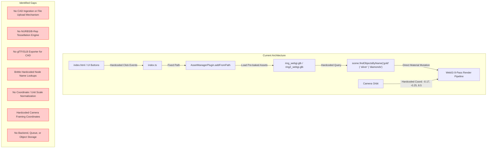
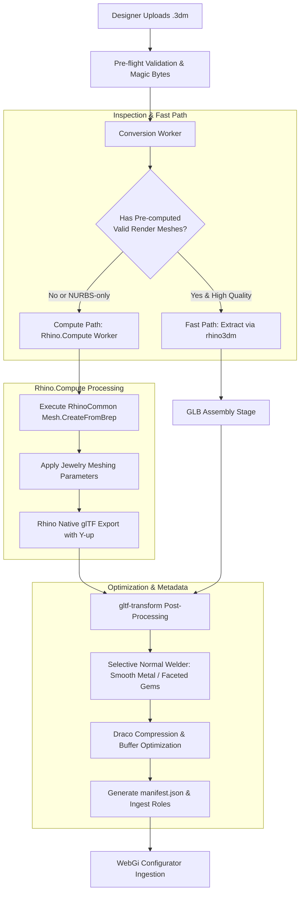
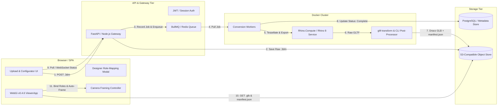
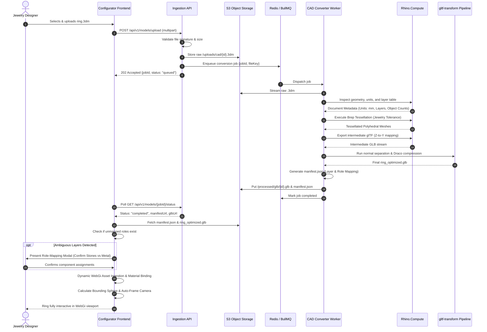
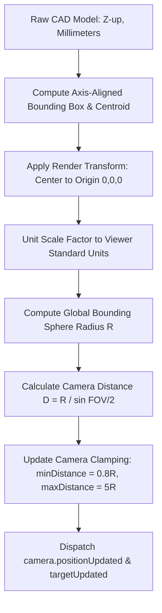
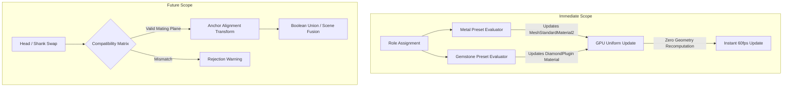
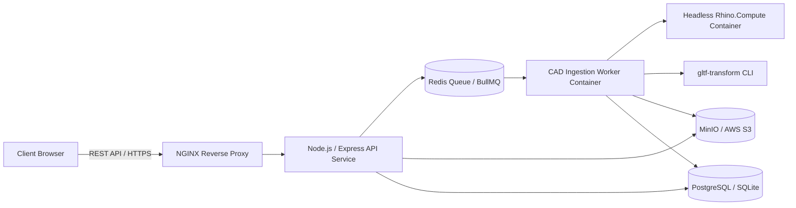
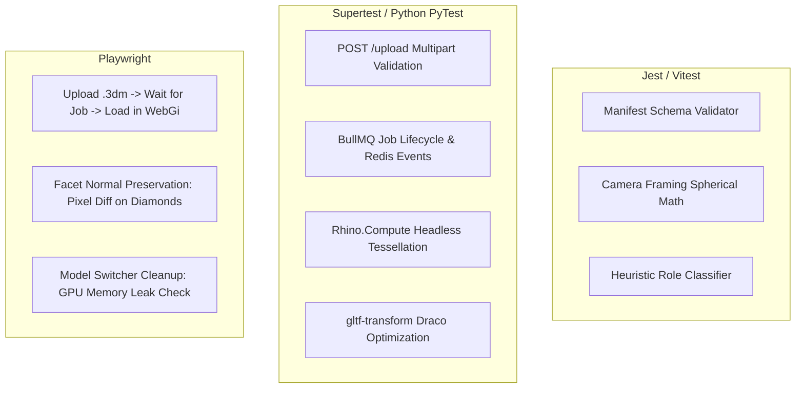
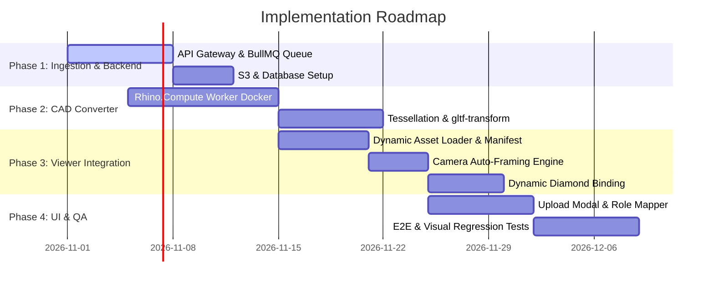

# Technical Implementation Plan: Rhino `.3dm` to glTF/GLB CAD Import Pipeline

> **Target System:** Existing 3D Ring Configurator (Three.js + WebGi v0.4.6)  
> **Author:** Senior 3D Graphics Engineer & CAD Systems Architect  
> **Status:** Proposed Architecture & Implementation Plan  
> **Document Location:** `CAD_3DM_IMPORT_PLAN.md`

---

## 1. Executive Summary

This document specifies the technical implementation plan for extending the existing 3D Ring Configurator to support designer-uploaded Rhino (`.3dm`) CAD models. 

The primary business and engineering objective is to enable jewelry designers to upload manufacturing CAD files (`.3dm`) created in Rhino (or jewelry plugins like MatrixGold/RhinoGold) and immediately visualize, evaluate, and configure them inside the high-end real-time web viewer.

### Core Architecture Principles
1. **Preserve the Existing Viewer Engine:** The existing Three.js + WebGi v0.4.6 graphics pipeline—including its 8 deferred and post-processing passes (GBuffer, SSAO, SSR, DiamondPlugin optical dispersion, Bloom, TAA, Tonemap, and Progressive accumulation)—is preserved in its entirety. The renderer is not replaced or rewritten.
2. **Asynchronous Headless CAD Conversion:** Standalone browsers cannot reliably tessellate arbitrary Non-Uniform Rational B-Splines (NURBS) or Boundary Representations (B-Reps). Conversion is offloaded to an asynchronous backend worker service powered by headless Rhino (`Rhino.Compute` / RhinoCommon) and optimized via `gltf-transform`.
3. **Decoupled Data Pipeline (GLB + Manifest):** The pipeline ingests `.3dm`, generates an optimized, Draco-compressed glTF 2.0 Binary (`.glb`) asset, and pairs it with a semantically rich, versioned `manifest.json`. The manifest decouples arbitrary CAD layer hierarchies from the viewer's configurable material and component roles.
4. **Render-Only Camera & Model Normalization:** Original CAD models are created in real-world units (typically millimeters) with arbitrary coordinate orientations (Z-up in Rhino). The ingestion pipeline maps coordinates to glTF standard (Y-up), centers the geometry, computes bounding dimensions, and dynamically frames the existing WebGi orbit camera without mutating the manufacturing CAD master.

---

## 2. Audit of the Existing Implementation

A forensic examination of the repository was performed across documentation, package manifests, build scripts, scene assets, and source code.

```
Repository Structure (Actual):
C:\Users\admin\Downloads\3D-app\
├── .gitignore
├── ARCHITECTURE.md          (Architecture documentation)
├── README.md                (User-facing project readme)
└── rendering/               (Active application root)
    ├── .gitignore
    ├── index.html           (SPA container and UI markup)
    ├── package.json         (Vite + WebGi dependencies)
    ├── package-lock.json
    ├── Readme.md            (WebGi template readme)
    ├── tsconfig.json
    ├── vite.config.mjs      (Vite build config with asset-copy plugin)
    ├── assets/
    │   ├── ring_webgi.glb   (Solitaire model, ~972 KB)
    │   ├── ring2_webgi.glb  (Pavé halo eternity model, ~1.12 MB)
    │   ├── ring2_webgi3.glb (~1.12 MB)
    │   ├── favicons/
    │   ├── images/          (UI icons and material swatches)
    │   └── sounds/          (music_loop.mp3)
    └── src/
        ├── index.ts         (Viewer setup, logic, hardcoded queries)
        ├── styles.scss      (UI styles)
        └── _variables.scss
```

### 2.1 Feature Verification Matrix

| System Component | Documented in `ARCHITECTURE.md` / `README.md` | Actually Implemented in Source (`rendering/src/index.ts`) | Verified by Automated Tests | Unverified / Missing from Codebase |
| :--- | :--- | :--- | :--- | :--- |
| **3D Engine Runtime** | Three.js + WebGi (v0.4.6) | **Yes** (`webgi@bundle-0.4.6.tgz`) | **No tests** | Clean typings incomplete; uses `any` casts |
| **Shader Passes (8 total)** | GBuffer, SSAO, SSR, Diamond, Bloom, TAA, Tonemap, Progressive | **Yes** (lines 71–89 in `index.ts`) | **No tests** | GroundPlugin and FrameFadePlugin active but omitted from doc diagrams |
| **Diamond Shader** | Volumetric refraction, TIR, dispersion (IOR = 2.417) | **Yes** (`DiamondPlugin` registered) | **No tests** | Relies on proprietary `WEBGI_materials_diamond` GLB extension |
| **Model Ingestion** | Dynamic GLB loader via `AssetManagerPlugin` | **Partial** (`manager.addFromPath` used for 2 hardcoded assets) | **No tests** | No dynamic pathing, no file upload input, no CAD parser |
| **Camera Controller** | `SerializableOrbitControls` with limits & auto-rotate | **Yes** (configured on `camera.controls`) | **No tests** | Hardcoded initial target `(0,0,0)` and distance `8.5` |
| **Material Switching** | Interactive metal and gem color palette | **Yes** (direct mutation of `o.material.color`) | **No tests** | Hardcoded to node names: `'gold'`, `'silver'`, `'alliance'`, `'entourage'` |
| **Gemstone Binding** | Multi-stone diamond configuration | **Brittle** (hardcoded to `'diamonds'`, `'diamonds001'`–`'diamonds005'`, and `'Object'`) | **No tests** | In `ring2_webgi.glb`, 60+ pavé stones (`dia001`–`dia044`, `diamond_side_*`) are ignored by color switcher! |
| **Backend & Ingestion API** | Implied CAD upload pipeline in task spec | **None** | **None** | No server, no REST endpoints, no background workers |
| **Database & Storage** | Not documented | **None** | **None** | No asset persistence or metadata store |
| **Save / Share Feature** | Claimed in `README.md` | **None** | **None** | Completely absent from source code |
| **Pan Camera Control** | Claimed enabled in `README.md` | **Explicitly disabled** (`enablePan = false`) | **No tests** | Documentation directly conflicts with code |

### 2.2 Forensic Inspection of Existing GLB Assets

Binary inspection of `rendering/assets/ring_webgi.glb` reveals critical implementation constraints:
- **Extensions Used:** `KHR_materials_clearcoat`, `KHR_materials_ior`, `KHR_materials_iridescence`, `KHR_draco_mesh_compression`, `WEBGI_viewer`, `WEBGI_materials_diamond`, `WEBGI_materials_bumpmap`, `WEBGI_materials_lightmap`, `WEBGI_object3d_extras`, `WEBGI_material_extras`.
- **Extension Required:** `KHR_draco_mesh_compression`.
- **Diamond Extension Payload (`WEBGI_materials_diamond`):**
  ```json
  {
    "name": "diamond",
    "type": "DiamondMaterial",
    "refractiveIndex": 2.4,
    "dispersion": 0.012,
    "reflectivity": 0.5,
    "rayBounces": 5,
    "geometryFactor": 0.5,
    "absorptionFactor": 1,
    "envMapIntensity": 1.25,
    "squashFactor": 0.98,
    "diamondOrientedEnvMap": 0,
    "boostFactors": { "x": 0.892, "y": 0.892, "z": 0.98595, "isVector3": true }
  }
  ```
- **Finding:** WebGi's `DiamondPlugin` automatically recognizes materials with this vendor extension. Custom GLBs generated from third-party CAD must either have this extension injected during post-processing or have WebGi's runtime `DiamondMaterial` assigned dynamically upon load.

---

## 3. Current Architecture and Identified Gaps



### Detailed Gap Breakdown

1. **CAD Format Gap:** WebGi and Three.js only ingest polygonal meshes packed in formats like glTF/GLB or OBJ. A Rhino `.3dm` file is an OpenNURBS container housing mathematical Brep geometry, spline curves, and metadata. Browsers cannot render Breps without tessellation.
2. **Tessellation & Normal Integrity Gap:** Standard 3D decimation or smoothing destroys jewelry. Diamonds require flat, un-smoothed facet normals so each facet behaves as an optical prism. Metals require smooth normals on continuous sweeps but sharp normals across parting lines. The existing app has no mechanism to enforce these rules on raw CAD files.
3. **Hardcoded Scene Graph Query Gap:** `index.ts` performs string searches for `'silver'`, `'gold'`, and `'diamonds'`. Real designer CAD files contain layers like `Layer 01`, `Default`, `HEAD_PLAT`, `GEM_ROUND_1CT`, or `FINGER_RAIL`. An arbitrary upload will immediately break material configuration.
4. **Coordinate & Unit Framing Gap:** Rhino uses a Z-up coordinate system and millimeters. GlTF uses Y-up and meters. WebGi scene units are arbitrarily scaled (camera distance 8.5). An un-normalized 20mm ring will appear misaligned, clipped, or outside the camera's clamping boundaries (`minDistance: 3`, `maxDistance: 20`).
5. **Infrastructure Gap:** The repo contains only client-side static assets. There is no server to handle uploads, no background worker to isolate expensive CAD calculations, and no cloud storage.

---

## 4. Recommended Conversion Strategy & Alternatives Evaluated

### 4.1 Comparative Evaluation of Conversion Strategies

| Evaluation Criteria | Option 1: Client-Side `rhino3dm.js` + Three.js | Option 2: Serverless / Pure OpenNURBS (`rhino3dm` Python) | Option 3: Rhino.Compute / Headless RhinoCommon (Recommended) | Option 4: Commercial Third-Party Conversion SaaS (e.g., Datasmith/Hoops) |
| :--- | :--- | :--- | :--- | :--- |
| **Geometry Fidelity** | Extremely Low (Fails on unmeshed Breps) | Low (Cannot mesh NURBS) | **Full Fidelity (Native Rhino meshing kernel)** | High |
| **NURBS/Brep Tessellation** | ❌ **Unsupported** (openNURBS lacks mesher) | ❌ **Unsupported** (openNURBS lacks mesher) | **Full Support** (`Mesh.CreateFromBrep`) | Supported |
| **Diamond Facet Normals** | Uncontrollable | Uncontrollable | **Precise Control** (custom `MeshingParameters`) | Moderate |
| **Direct GLB Export** | ❌ Requires custom Three.js export | ❌ Requires secondary converter | **Native Support** (`FileGltfWriteOptions`) | High |
| **Performance & Scalability** | Low (freezes browser, high bandwidth) | High (lightweight container) | High (scalable background worker pool) | Variable (API rate limits) |
| **Deployment / Container** | Client browser only | Linux Docker container | Windows Container or Rhino 8 Linux Docker | Proprietary Cloud |
| **Licensing & Cost** | Open source (MIT) | Open source (MIT) | McNeel Core-Hour ($0.10/core-hr) or Team seat | High subscription ($10k+/yr) |
| **Operational Feasibility** | Unviable for production jewelry CAD | Unviable for files saved without render meshes | **Technically complete & industry standard** | Vendor lock-in risk |

#### Critical Finding Regarding `rhino3dm` / OpenNURBS
According to official [McNeel openNURBS Documentation](https://www.rhino3d.com/features/opennurbs/), `rhino3dm` is a standalone geometry serialization and evaluation library. **It does not contain the proprietary surface mesher (`Rhino.Geometry.Mesh.CreateFromBrep`)**. 
If a jewelry designer saves a `.3dm` file with "Save Small" (which strips cached render meshes) or creates parametric surfaces in Grasshopper without baking display meshes, `rhino3dm` cannot extract renderable geometry. 

### 4.2 Recommended Approach: Two-Tier Hybrid Pipeline with Rhino.Compute

We recommend a **Two-Tier Hybrid Worker Pipeline** powered by **Rhino.Compute / RhinoCommon** paired with **`gltf-transform`**:



#### Why Rhino.Compute Wins
1. **True CAD Kernel:** Accurately processes closed polysurfaces, trimmed NURBS, and SubD solids created in Rhino 7 and 8.
2. **Jewelry-Grade Meshing:** Exposes `MeshingParameters.QualityRenderMesh` with configurable chordal height tolerances ($\leq 0.005$ mm), ensuring zero visible polygonal facets on rounded shanks while keeping diamond facets perfectly flat.
3. **Native glTF Export:** RhinoCommon's `FileGltfWriteOptions` supports mapping Z-up to Y-up, exporting layer hierarchies, and embedding vertex attributes directly into `.glb`.
4. **Licensing:** Supported by McNeel Core-Hour billing ($0.10 per core-hour), allowing cost-effective horizontal scaling on AWS or Azure containers.

---

## 5. Target Architecture Diagram



---

## 6. Detailed `.3dm`-to-GLB Data Flow



### 6.1 Geometry Handling Strategy

| CAD Geometry Type | Supported? | Processing / Tessellation Strategy | Output in GLB |
| :--- | :---: | :--- | :--- |
| **Closed Polysurfaces / Breps (Metal)** | **Yes** | Tessellated via RhinoCommon using angle tolerance 20°, chordal tolerance 0.005mm. Vertex normals welded with 35° edge threshold to preserve smooth organic sweeps while retaining sharp decorative edges. | Triangle Mesh (`MeshStandardMaterial2`) |
| **Closed Polysurfaces / Breps (Gems)** | **Yes** | Tessellated using planar preservation. **Normals are NEVER smoothed or welded across facet boundaries.** Every facet vertex receives an independent, planar normal vector. | Triangle Mesh (`DiamondPlugin` / `DiamondMaterial`) |
| **Existing Mesh Geometry** | **Yes** | Validated for non-manifold edges, self-intersections, and inverted normals. Tessellation skipped; vertex buffers re-indexed. | Triangle Mesh |
| **Extrusions & SubD Surfaces** | **Yes** | Converted to Brep representation, then tessellated using Brep meshing pipeline. | Triangle Mesh |
| **Open Surfaces / Polysurfaces** | **Warning** | Flagged in manifest as non-watertight. Tessellated with two-sided material flags enabled in glTF to prevent back-face culling artifacts. | Triangle Mesh |
| **NURBS Curves (Rails, Centerlines)** | **Filtered** | Excluded from the renderable GLB geometry. Finger rails, cutter curves, and sweep guides are stripped to reduce asset size. | Ignored / Omitted from GLB |
| **Cutters / Boolean Negative Volumes** | **Filtered** | Identified by layer naming convention (`Cutter`, `Cut`, `Boolean`) or hidden visibility attribute; purged from export. | Purged |
| **Point Objects & Annotations** | **Filtered** | Stripped during export. | Omitted from GLB |

---

## 7. Rendering Integration Plan

### 7.1 Preserving the 8-Pass WebGi Pipeline

The existing application initializes WebGi in `rendering/src/index.ts` with 8 critical post-processing and deferred passes. These passes **must not be modified, re-ordered, or replaced**:

```typescript
// Preserved exact pipeline from rendering/src/index.ts:
await viewer.addPlugin(GBufferPlugin)
await viewer.addPlugin(new ProgressivePlugin(32))
await viewer.addPlugin(new TonemapPlugin(true, false, [
    `vec4 vignette(vec4 color, vec2 uv, float offset, float darkness){
        uv = ( uv - vec2( 0.5 ) ) * vec2( offset );
        return vec4( mix( color.rgb, vec3( 0.17, 0.00, 0.09 ), dot( uv, uv ) ), color.a );
    }`,
    `gl_FragColor = vignette(gl_FragColor, vUv, 1.1, 0.8);`
]))
const ssr = await viewer.addPlugin(SSRPlugin)
const ssao = await viewer.addPlugin(SSAOPlugin)
await viewer.addPlugin(FrameFadePlugin)
await viewer.addPlugin(GroundPlugin)
const bloom = await viewer.addPlugin(BloomPlugin)
await viewer.addPlugin(TemporalAAPlugin)
await viewer.addPlugin(DiamondPlugin)
await viewer.addPlugin(RandomizedDirectionalLightPlugin, false)
```

### 7.2 Dynamic Asset Loading & Resource Cleanup

The current `loadNewModel()` implementation in `index.ts` hardcodes model paths and leaks GPU resources over time. The dynamic loading architecture replaces this with a managed lifecycle:

```typescript
// Proposed Dynamic Loader Architecture in rendering/src/cad/DynamicCadLoader.ts
export class DynamicCadLoader {
    private viewer: ViewerApp;
    private assetManager: AssetManagerPlugin;
    private currentModelRoot: any = null;
    private activeDiamondMeshes: any[] = [];
    private activeMetalMeshes: Map<string, any[]> = new Map();

    constructor(viewer: ViewerApp) {
        this.viewer = viewer;
        this.assetManager = viewer.getPlugin(AssetManagerPlugin)!;
    }

    public async loadCustomModel(glbUrl: string, manifest: ModelManifest): Promise<void> {
        // 1. Reset temporal buffers & prevent rendering stale history
        this.viewer.renderer.reset();

        // 2. Unload previous model & dispose GPU geometry/textures
        if (this.currentModelRoot) {
            this.viewer.scene.removeSceneModels();
            this.activeDiamondMeshes.length = 0;
            this.activeMetalMeshes.clear();
        }

        // 3. Ingest GLB via WebGi AssetManager
        const importedObjects = await this.assetManager.addFromPath(glbUrl);
        this.currentModelRoot = importedObjects[0] || this.viewer.scene.modelRoot;

        // 4. Bind Materials & Plugins according to Model Manifest
        this.bindRolesFromManifest(manifest);

        // 5. Normalization & Camera Auto-Framing
        this.frameCameraToModel(this.currentModelRoot, manifest);

        // 6. Invalidate pipeline & trigger progressive convergence
        this.viewer.renderer.refreshPipeline();
        this.viewer.renderer.reset();
    }
}
```

### 7.3 Diamond Material Assignment Strategy

When importing custom GLB files that do not have pre-baked `WEBGI_materials_diamond` extensions, the viewer must dynamically configure WebGi's `DiamondPlugin`:

1. **Mesh Identification:** The loader queries meshes using stable node identifiers provided by `manifest.json` whose assigned role is `diamond`, `colored_gemstone`, or `accent_stone`.
2. **Facet Normal Verification:** The loader verifies that vertex normals are not indexed smoothly across distinct faces (`geometry.hasAttribute('normal')`).
3. **Diamond Material Instantiation:**
   ```typescript
   private applyDiamondPluginToMesh(mesh: any, gemColor: Color): void {
       const diamondPlugin = this.viewer.getPlugin(DiamondPlugin)!;
       
       // Configure diamond material parameters
       const diamondMat = new (diamondPlugin as any).DiamondMaterial({
           color: gemColor,
           refractiveIndex: 2.417,
           dispersion: 0.012,
           reflectivity: 0.5,
           rayBounces: 5,
           geometryFactor: 0.5,
           absorptionFactor: 1.0,
           envMapIntensity: 1.25
       });

       mesh.material = diamondMat;
       this.activeDiamondMeshes.push(mesh);
   }
   ```
4. **Metal Material Instantiation:** Meshes assigned to `metal_shank`, `metal_head`, or `metal_prongs` receive WebGi's `MeshStandardMaterial2`:
   ```typescript
   private applyMetalMaterial(mesh: any, metalPreset: MetalPreset): void {
       mesh.material = new MeshStandardMaterial2({
           color: metalPreset.color,
           roughness: 0.18,
           metalness: 1.0,
           envMapIntensity: 1.5
       });
   }
   ```

---

## 8. Camera Normalization & Framing Strategy

### 8.1 Render-Only Coordinate & Unit Normalization

Uploaded CAD rings will arrive with varying units (millimeters, centimeters, inches) and bounding sizes (e.g., standard inner diameter $16.5$ mm to $21.0$ mm). 

**Rule:** The original CAD file is never mutated. Normalization occurs exclusively at the GLB transformation node and WebGi camera layer.



### 8.2 Auto-Framing Formulation

Given the computed bounding sphere radius $R$ and camera field-of-view $\theta$ (in radians):

$$D = \frac{R}{\sin(\theta / 2)} \times 1.25$$

```typescript
export function autoFrameCamera(camera: any, modelRoot: any, controls: any): void {
    // 1. Compute world bounding box & sphere
    const bbox = new Box3().setFromObject(modelRoot);
    const center = new Vector3();
    const sphere = new Sphere();
    bbox.getCenter(center);
    bbox.getBoundingSphere(sphere);

    // 2. Center model to world origin (0, 0, 0)
    modelRoot.position.sub(center);
    modelRoot.updateMatrixWorld(true);

    // 3. Compute optimal distance
    const fov = (camera.fov || 45) * (Math.PI / 180);
    const distance = (sphere.radius / Math.sin(fov / 2)) * 1.25;

    // 4. Update Orbit Controls Clamping Limits
    if (controls) {
        controls.minDistance = sphere.radius * 0.8;
        controls.maxDistance = sphere.radius * 6.0;
        controls.target.set(0, 0, 0);
        controls.update();
    }

    // 5. Smoothly animate camera to home framing
    gsap.to(camera.position, {
        x: -0.17 * (distance / 8.5),
        y: -0.25 * (distance / 8.5),
        z: distance,
        duration: 1.2,
        ease: "power2.inOut",
        onUpdate: () => {
            camera.positionUpdated(true);
            camera.targetUpdated(true);
        }
    });
}
```

### 8.3 Dynamic Gemstone Macro-Focus

Instead of the hardcoded coordinates in `index.ts` (`position: (1.6, 3.66, 2.55)`), macro-focus on gemstones computes the actual centroid of meshes mapped to `diamond` or `colored_gemstone`:

$$\mathbf{c}_{\text{gem}} = \frac{1}{N}\sum_{i=1}^N \text{Centroid}(\text{GemMesh}_i)$$

The camera tweens along a normal vector offset from $\mathbf{c}_{\text{gem}}$, maintaining perfect focus regardless of ring size or stone orientation.

---

## 9. Model-Manifest Schema with an Example

### 9.1 JSON Schema Specification (`model-manifest.schema.json`)

The manifest establishes a contract between the CAD ingestion pipeline and the client-side configurator.

```json
{
  "$schema": "http://json-schema.org/draft-07/schema#",
  "title": "ModelManifest",
  "type": "object",
  "required": [
    "schemaVersion",
    "modelId",
    "timestamp",
    "units",
    "boundingDimensions",
    "components"
  ],
  "properties": {
    "schemaVersion": { "type": "string", "enum": ["1.0.0"] },
    "modelId": { "type": "string", "format": "uuid" },
    "originalFileName": { "type": "string" },
    "timestamp": { "type": "string", "format": "date-time" },
    "units": { "type": "string", "enum": ["mm", "cm", "m", "inches"] },
    "boundingDimensions": {
      "type": "object",
      "required": ["width", "height", "depth", "boundingRadius"],
      "properties": {
        "width": { "type": "number" },
        "height": { "type": "number" },
        "depth": { "type": "number" },
        "boundingRadius": { "type": "number" }
      }
    },
    "components": {
      "type": "array",
      "items": {
        "type": "object",
        "required": ["nodeId", "nodeName", "sourceLayer", "role", "geometryStats"],
        "properties": {
          "nodeId": { "type": "string" },
          "nodeName": { "type": "string" },
          "sourceLayer": { "type": "string" },
          "role": {
            "type": "string",
            "enum": [
              "metal_shank",
              "metal_head",
              "metal_prongs",
              "diamond",
              "colored_gemstone",
              "accent_stone",
              "unassigned"
            ]
          },
          "roleConfidence": { "type": "number", "minimum": 0, "maximum": 1 },
          "defaultMaterialPreset": { "type": "string" },
          "geometryStats": {
            "type": "object",
            "properties": {
              "triangleCount": { "type": "integer" },
              "vertexCount": { "type": "integer" },
              "isWatertight": { "type": "boolean" },
              "facetNormalsPreserved": { "type": "boolean" }
            }
          }
        }
      }
    },
    "warnings": {
      "type": "array",
      "items": { "type": "string" }
    }
  }
}
```

### 9.2 Realistic Manifest Example (`manifest.json`)

```json
{
  "schemaVersion": "1.0.0",
  "modelId": "c4b3a1d2-7e8f-4a5b-9c0d-1e2f3a4b5c6d",
  "originalFileName": "Solitaire_Round_2ct_Ring.3dm",
  "timestamp": "2026-10-26T14:30:00Z",
  "units": "mm",
  "boundingDimensions": {
    "width": 21.4,
    "height": 26.8,
    "depth": 8.2,
    "boundingRadius": 14.1
  },
  "components": [
    {
      "nodeId": "mesh_node_001",
      "nodeName": "Main_Shank_Solid",
      "sourceLayer": "SHANK::METAL",
      "role": "metal_shank",
      "roleConfidence": 0.95,
      "defaultMaterialPreset": "white_gold_18k",
      "geometryStats": {
        "triangleCount": 18420,
        "vertexCount": 9212,
        "isWatertight": true,
        "facetNormalsPreserved": false
      }
    },
    {
      "nodeId": "mesh_node_002",
      "nodeName": "Six_Prong_Head",
      "sourceLayer": "HEAD::PRONGS",
      "role": "metal_prongs",
      "roleConfidence": 0.92,
      "defaultMaterialPreset": "platinum",
      "geometryStats": {
        "triangleCount": 8960,
        "vertexCount": 4482,
        "isWatertight": true,
        "facetNormalsPreserved": false
      }
    },
    {
      "nodeId": "mesh_node_003",
      "nodeName": "Center_Round_Diamond",
      "sourceLayer": "GEMS::CENTER_STONE",
      "role": "diamond",
      "roleConfidence": 0.99,
      "defaultMaterialPreset": "diamond_clear",
      "geometryStats": {
        "triangleCount": 114,
        "vertexCount": 59,
        "isWatertight": true,
        "facetNormalsPreserved": true
      }
    }
  ],
  "warnings": [
    "Layer 'CONSTRUCTION_LINES' contained 4 NURBS curves which were excluded from GLB export."
  ]
}
```

### 9.3 Designer Role-Mapping Modal (UI Fallback)

If a designer uploads a `.3dm` file with uninformative layers (`Default`, `Layer 01`, `Object`), the automated role classifier marks components as `unassigned` (confidence $< 0.5$). 
The client UI presents an interactive Role-Mapping Modal before rendering:
- Displays an interactive 3D clay preview of the meshes.
- Hovering/clicking a mesh highlights it.
- Dropdown selector allows the designer to designate: `Metal Shank`, `Metal Prongs`, `Diamond (Center)`, `Accent Gems`.
- Upon confirmation, the updated mapping is saved back to `manifest.json`.

---

## 10. Configuration-Engine Design

### 10.1 Separation of Concerns: Material vs. Geometry Configuration

The configuration engine operates strictly on two distinct tiers:



#### Why Uploading an Arbitrary CAD Ring Does Not Enable Geometry Swapping
Jewelry CAD files are modeled as solid, fused units or custom assemblies where the head fits the curvature of that specific shank. Arbitrary uploaded rings **cannot** have their heads or shanks swapped without:
1. Defined anchor coordinate frames (mating planes, rail curves).
2. Curvature blending specifications.
3. Gemstone seat clearances.
Material configuration is 100% supported on all uploaded models; geometry swapping is restricted to pre-validated modular component libraries.

### 10.2 Configuration State Persistence Schema

```typescript
export interface RingConfigurationState {
    version: "1.0.0";
    modelId: string;
    timestamp: string;
    materials: {
        shank: {
            presetId: "yellow_gold_18k" | "white_gold_18k" | "rose_gold_18k" | "platinum";
            customColorHex?: string;
        };
        head?: {
            presetId: "platinum" | "white_gold_18k";
        };
        centerStone: {
            gemType: "diamond" | "ruby" | "emerald" | "sapphire" | "fancy_blue";
            colorHex: string;
        };
        accentStones?: {
            gemType: "diamond";
            colorHex: string;
        };
    };
    cameraView: {
        distance: number;
        phi: number;
        theta: number;
    };
}
```

---

## 11. Backend, Storage, and Job-Processing Design

Because the existing repository is a client-only static application, the backend is designed from first principles with minimal footprint and maximum reliability.



### 11.1 API Specification

| Method | Endpoint | Description | Request Payload | Response |
| :--- | :--- | :--- | :--- | :--- |
| `POST` | `/api/v1/models/upload` | Upload `.3dm` CAD file | `multipart/form-data` (`file`) | `202 Accepted` `{ jobId, modelId, status }` |
| `GET` | `/api/v1/jobs/:jobId` | Poll conversion progress | None | `200 OK` `{ status, progress, error }` |
| `GET` | `/api/v1/models/:modelId/manifest` | Retrieve generated manifest | None | `200 OK` `ModelManifest JSON` |
| `GET` | `/api/v1/models/:modelId/model.glb` | Fetch optimized GLB asset | None | `200 OK` `model/gltf-binary` |
| `PUT` | `/api/v1/models/:modelId/manifest` | Update role mappings | `{ components: [...] }` | `200 OK` Updated manifest |

### 11.2 Conversion Queue Architecture (BullMQ)

CAD tessellation is computationally heavy (1–15 seconds of CPU time). Running it synchronously in the HTTP request loop would exhaust server worker threads and trigger gateway timeouts.
- **Queue Engine:** BullMQ on Redis.
- **Concurrency Control:** Worker concurrency clamped to $1$ job per available physical CPU core.
- **Timeout & Retry Policy:** 90-second execution deadline. Maximum 1 automatic retry (to recover from transient out-of-memory spikes; persistent malformed geometry fails immediately).

---

## 12. Security and Performance Strategy

### 12.1 Acceptance & Performance Targets

| Metric | Target / Threshold | Validation Method |
| :--- | :--- | :--- |
| **Max Input File Size** | 100 MB | Enforced at NGINX proxy and API multipart parser |
| **Max Triangle Count** | 500,000 triangles total | Enforced during GLB export optimization |
| **Max Generated GLB Size** | $\leq 3.5$ MB | Draco compression validation in worker |
| **Conversion Latency** | $< 15$ seconds for standard rings | Monitored via BullMQ job duration metrics |
| **Viewer Load Time** | $< 2.0$ seconds on 4G network | WebGi asset load event timing |
| **Frame Rate (Desktop)** | Sustained 60 FPS | Chrome DevTools Performance audit |
| **Frame Rate (Mobile)** | Sustained 30–60 FPS | Dynamic pass throttling (bloom disabled, SSR step count halved) |
| **Worker Peak RAM** | $\leq 3.5$ GB per worker container | Docker cgroups memory limit (`mem_limit: 4g`) |

### 12.2 Security Hardening
1. **Magic Byte Inspection:** Reject files based on binary signature rather than extension alone. Rhino 3DM files begin with OpenNURBS signature bytes (`3D Bi-orthogonal...`).
2. **Worker Sandbox Isolation:** Rhino.Compute runs in an isolated container without network egress to prevent Server-Side Request Forgery (SSRF) or unauthorized data exfiltration.
3. **Zip-Bomb / Poly-Bomb Protection:** Tessellation parameters enforce an upper limit on generated triangles (`GridMaxSubdivisions: 500`). If a malformed CAD model attempts to generate $> 1,000,000$ triangles, the worker aborts and raises an `ExcessiveGeometricComplexityError`.

---

## 13. Testing and Acceptance Strategy

### 13.1 Test Suite Breakdown



### 13.2 Minimum End-to-End Acceptance Test
1. An operator uploads a verified test ring file (`Solitaire_Test_Ring.3dm`).
2. The ingestion API accepts the file and queues the job.
3. The conversion worker generates `model.glb` ($\leq 3.5$ MB) and `manifest.json`.
4. The WebGi viewer loads the custom GLB without console errors or shader crashes.
5. The model is centered at `(0, 0, 0)` and properly framed by the orbit camera.
6. The diamond center stone exhibits sharp facet reflections and dispersion.
7. Changing the metal preset to "Rose Gold" updates the shank color immediately.
8. Orbiting and zooming operates smoothly at 60 FPS without jitter or clipping.

---

## 14. Ordered Implementation Phases



### Phase 1: Ingestion Service & Data Model
- **Prerequisites:** Docker, Node.js / Python environment, Redis instance.
- **Deliverables:** API server with `/api/v1/models/upload`, S3 file storage integration, BullMQ worker scaffold.
- **Completion Criteria:** File uploaded via curl stores in S3 and logs job in Redis.

### Phase 2: CAD Conversion Service (Rhino.Compute)
- **Prerequisites:** Rhino 8 license or McNeel Core-Hour billing token.
- **Deliverables:** Dockerized conversion worker, RhinoCommon C#/Python export script, `gltf-transform` Draco optimization pipeline.
- **Completion Criteria:** Sample `.3dm` converted to valid, Draco-compressed GLB with sharp diamond facet normals.

### Phase 3: Viewer Refactoring & Dynamic Asset Loader
- **Prerequisites:** Converted GLB and manifest from Phase 2.
- **Deliverables:** `DynamicCadLoader.ts`, `CameraFraming.ts`, manifest-based material role binder.
- **Completion Criteria:** Viewer loads custom GLB by URL, binds diamond and metal shaders, centers geometry, and frames camera.

### Phase 4: Designer UI & Role-Mapping Interface
- **Prerequisites:** Frontend build setup in `rendering/`.
- **Deliverables:** Upload drag-and-drop modal, conversion progress indicator, interactive role-mapping modal.
- **Completion Criteria:** Designer completes end-to-end upload and preview from browser UI.

### Phase 5: Verification, Hardening & Production Release
- **Prerequisites:** Complete Phase 1–4 implementation.
- **Deliverables:** Playwright visual regression suite, memory leak profiling, Docker compose production harness.
- **Completion Criteria:** All acceptance criteria in Section 12 and 13 pass.

---

## 15. File-by-File Change Plan Based on Actual Repository Files

```
Repository File Changes:
rendering/
├── package.json         [MODIFY] Add axios, uuid, and gltf-transform client utilities
├── src/
│   ├── index.ts         [MODIFY] Decouple hardcoded queries; delegate to DynamicCadLoader
│   ├── styles.scss      [MODIFY] Add styles for upload modal, progress bar, role mapper
└── index.html           [MODIFY] Add upload button & modal markup
```

### 15.1 Modifications to Existing Files

#### `rendering/package.json`
- **Action:** Retain all WebGi and GSAP dependencies.
- **Additions:** Add `axios` (for API polling) and `three-stdlib` (if bounding box helpers are needed). Clean up unused legacy `parcel-bundler` dependencies.

#### `rendering/src/index.ts`
- **Action:** Refactor `setupViewer()`:
  - Remove hardcoded queries for `'silver'`, `'gold'`, `'diamonds'`.
  - Replace static `manager.addFromPath("./assets/ring_webgi.glb")` with initialization of `DynamicCadLoader`.
  - Connect existing UI color pickers (`.ruby`, `.faint`, `.silver-gold`) to `ConfiguratorStateStore` instead of hardcoded DOM loops.
  - Retain exact plugin initialization sequence (GBuffer, SSAO, SSR, Diamond, Bloom, TAA, Tonemap, Progressive).

#### `rendering/index.html`
- **Action:** Add file upload trigger button to `.header--controls`. Add modal markup for file dropzone, progress spinner, and role assignment table.

#### `rendering/src/styles.scss`
- **Action:** Add responsive styles matching existing luxury salmon/text palette (`#E6BFBE` and `#52322B`) for modal dialogs and progress bars.

---

## 16. New Files and Modules Expected to be Added

```
New Modules & Services:
backend/
├── src/
│   ├── api/
│   │   ├── server.ts                 # Express/FastAPI Gateway
│   │   ├── routes/upload.ts          # Multipart upload handler
│   │   └── routes/jobs.ts            # Job status polling endpoint
│   ├── queue/
│   │   ├── queueManager.ts           # BullMQ Redis client
│   │   └── worker.ts                 # Background conversion worker
│   └── storage/
│       └── s3Client.ts               # Object storage abstraction
converter/
├── Dockerfile.rhino                  # Headless Rhino.Compute container
├── scripts/
│   ├── export_glb.py                 # RhinoCommon glTF exporter script
│   ├── meshing_parameters.py         # Jewelry tolerance configurations
│   └── optimize_glb.js               # gltf-transform Draco & normal script
rendering/src/cad/
├── DynamicCadLoader.ts               # WebGi asset lifecycle manager
├── ModelManifest.ts                  # Manifest TypeScript interfaces
├── MaterialRoleBinder.ts             # Semantic role to WebGi material bridge
└── CameraFramingController.ts        # Bounding sphere & camera framing math
rendering/src/ui/
├── UploadModal.ts                    # Drag-and-drop file upload UI
└── RoleMappingModal.ts               # Interactive layer-to-role mapper
docker-compose.yml                    # Multi-container orchestration
```

---

## 17. Dependencies, Licensing, Deployment & Cost Estimates

### 17.1 Technology Licenses
- **WebGi:** Requires commercial WebGi license for production commercial deployment.
- **Rhino.Compute:** Licensed via **McNeel Core-Hour Billing** ($0.10/vCPU-hour) on server operating systems. Local development can utilize existing commercial/educational desktop Rhino licenses for free.
- **Three.js & gltf-transform:** MIT License (Permissive open source).
- **BullMQ / Redis:** MIT / BSD-3 License.

### 17.2 Estimated Infrastructure Monthly Cost (AWS Production Baseline)

| Component | Specification | Estimated Monthly Cost |
| :--- | :--- | :--- |
| **API & Web Gateway** | AWS ECS / Fargate (2 vCPU, 4 GB RAM) | $45.00 |
| **Conversion Worker** | AWS EC2 `c6i.xlarge` (4 vCPU, 8 GB RAM) spot/on-demand | $120.00 |
| **Rhino Core-Hour Billing** | 4 cores @ $0.10/hr (assuming active 10 hrs/day) | $120.00 |
| **Object Storage (S3)** | 250 GB storage + data transfer out | $15.00 |
| **Managed Redis (ElastiCache)** | `cache.t4g.micro` | $18.00 |
| **Total Estimated Run-Rate** | | **~$318.00 / month** |

---

## 18. Technical Risks, Unknowns, and Unresolved Decisions

### 18.1 High-Priority Technical Risks

1. **WebGi Proprietary Diamond Extension Integration:**
   - *Risk:* Binary inspection proved that WebGi uses `WEBGI_materials_diamond` to serialize diamond optical parameters. If custom GLBs lack this extension, runtime assignment via `new (DiamondPlugin as any).DiamondMaterial()` must be used.
   - *Mitigation:* Verified that WebGi's `DiamondPlugin` allows programmatic assignment of materials at runtime. Alternatively, inject the extension JSON directly into the GLB JSON chunk during the `gltf-transform` post-processing stage.
2. **Rhino.Compute Linux Support vs. Windows Containers:**
   - *Risk:* Rhino 8 offers Linux container support, but certain RhinoCommon geometry methods have historical edge cases on Linux compared to native Windows.
   - *Resolution Required:* Validate Rhino 8 Linux container on AWS ECS; fallback to Windows Server 2022 AMI if meshing bugs occur.
3. **Dirty Designer CAD Files:**
   - *Risk:* Designers often leave hidden cutter bodies, non-manifold Boolean remnants, and unclosed surfaces in manufacturing files.
   - *Mitigation:* The manifest generator flags non-watertight geometry and surfaces marked hidden in the CAD layer table, excluding them from default visualization.

### 18.2 Unresolved Architectural Decisions

| # | Decision Item | Option A | Option B (Recommended) | Trade-Off |
| :---: | :--- | :--- | :--- | :--- |
| **1** | **Diamond Material Injection** | Inject `WEBGI_materials_diamond` into GLB binary during worker stage | Assign `DiamondMaterial` dynamically in TypeScript at runtime | Option B keeps GLB standard-compliant (glTF 2.0) and avoids reverse-engineering vendor metadata. |
| **2** | **Worker Operating System** | Windows Server Container | Ubuntu Linux Container with Rhino 8 | Linux is significantly cheaper and faster to spin up; requires validation of Rhino 8 Linux mesher. |
| **3** | **Role Mapping Persistence** | Store role overrides in `manifest.json` on S3 | Store role overrides in PostgreSQL relational DB | S3 keeps the asset bundle self-contained; DB allows fast query indexing. |

---

## 19. Definition of Done

The CAD import feature is considered complete and production-ready only when all of the following conditions are met:

- [ ] Exactly zero modifications are made to WebGi's 8 post-processing shader passes.
- [ ] A designer can upload an arbitrary `.3dm` file via the browser UI.
- [ ] The backend API validates, stores, and queues the file without timing out.
- [ ] The conversion worker tessellates NURBS/Brep geometry with jewelry-grade tolerance ($\leq 0.005$ mm).
- [ ] Converted diamond meshes retain flat facet normals without vertex smoothing.
- [ ] A valid glTF 2.0 Binary (`.glb`) with Draco compression and a `manifest.json` are generated.
- [ ] The WebGi configurator unloads existing models, disposes GPU resources, and loads the new GLB.
- [ ] Temporal rendering buffers (TAA and Progressive accumulation) reset without ghosting artifacts.
- [ ] The ring is centered at `(0, 0, 0)` and auto-framed by the orbit camera.
- [ ] The existing metal and gemstone color palettes configure the custom ring based on semantic roles.
- [ ] If layer names are ambiguous, the designer can map roles using the interactive UI modal.
- [ ] Sustained 60 FPS rendering on desktop workstations.
- [ ] All automated unit, integration, and visual regression tests pass.
