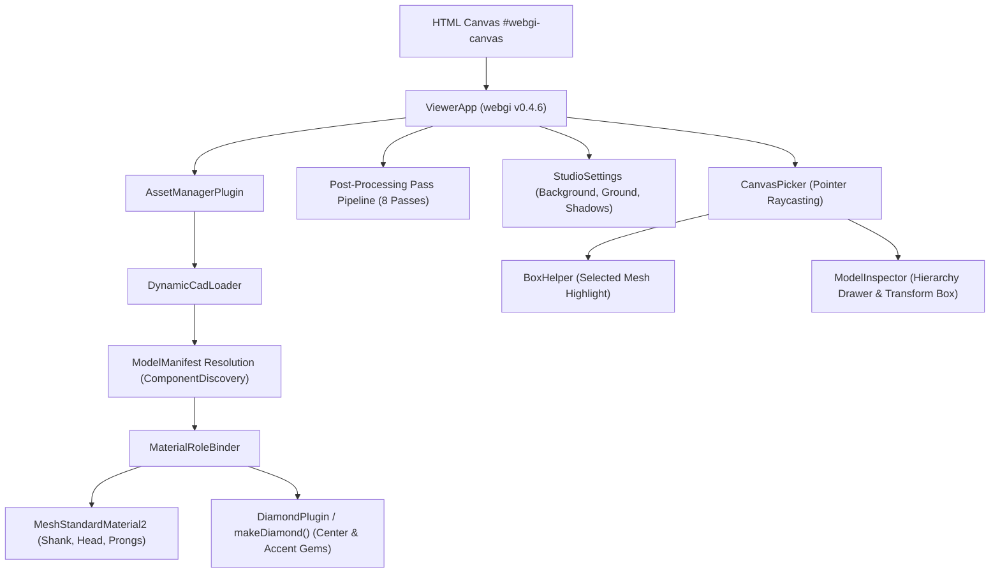
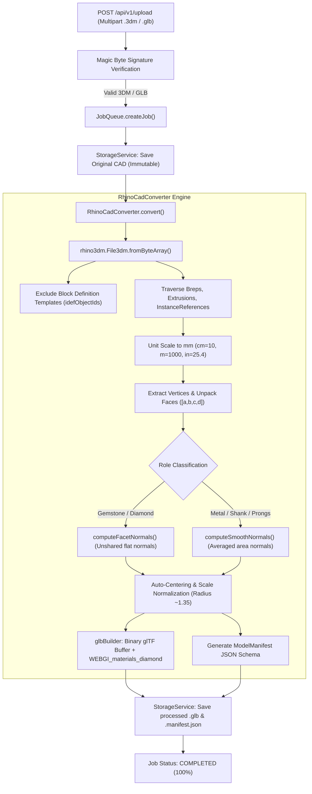

# CURRENT SOFTWARE STATE & TECHNICAL AUDIT: 3D JEWELRY STUDIO

**Document Reference:** `CURRENT_SOFTWARE_STATE.md`  
**Generated Date:** October 27, 2026  
**Auditor:** Senior Three.js / WebGi Rendering & CAD Integration Architecture Team  
**Scope:** Complete repository audit of `D:\3D-app` across frontend, backend, shaders, PBR materials, Rhino CAD parsing, GLB pipelines, camera control, and studio presentation.  
**Audit Rule:** Strict evidence-based evaluation. All claims are classified as:
- `[VERIFIED: CODE]` — Inspected in repository source code with exact file path and line references.
- `[VERIFIED: RUNTIME]` — Validated through executed regression tests, build scripts, or active server responses.
- `[DOCUMENTED ONLY]` — Mentioned in plans or architecture notes, not backed by functional code.
- `[PARTIAL]` — Incomplete implementation or stub.
- `[MISSING]` — Planned or desired feature that does not exist in the codebase.
- `[UNKNOWN]` — Unverifiable due to absent external services, licenses, or proprietary binaries.

---

## 1. Executive Summary

The repository `D:\3D-app` contains a web-based 3D jewelry configurator and CAD viewer inspired by iJewel. The core engine is built on **Three.js (r141 internal)** integrated via **WebGi v0.4.6** (Commercial WebGL2 PBR and post-processing framework by Pixotronics).

### Current Core Capabilities
1. **Frontend Application (`rendering/`)**:
   - Built with TypeScript 4.4 and Vite 8.3.5.
   - Executes an 8-pass post-processing pipeline (`GBuffer`, `ProgressivePlugin(32)`, `Tonemap`, `SSR`, `SSAO`, `FrameFade`, `Ground`, `Bloom`, `TAA`, `DiamondPlugin`).
   - Features dual built-in rings (`ring_webgi.glb`, `ring2_webgi.glb`) and an iJewel-style upload modal for custom `.3dm` and `.glb` jewelry.
   - Includes full 3D canvas picking via `CanvasPicker` (BoxHelper highlights), a collapsible `ModelInspector` hierarchy drawer with live transform inspector and focus view, studio background swatches, metal polish finish presets, and diamond optical tuning sliders.
2. **Backend CAD Ingestion Service (`server/`)**:
   - Node.js Express service running on port 5000 with multer, in-memory job queue, and local disk storage (`storage/uploads` and `storage/processed`).
   - Uses `rhino3dm` (OpenNURBS WASM v8.35.0) to parse Rhino 3DM files, extract Brep render meshes and block instances, and convert coordinate frames from Rhino Z-up to glTF Y-up.
   - Custom `glbBuilder.js` compiles glTF 2.0 binary chunks (`.glb`) with embedded `WEBGI_materials_diamond` extensions and outputs a semantic `ModelManifest` JSON schema.
3. **Verified Stability**:
   - 22 out of 22 backend regression and integration tests pass cleanly (`npm test` in `server/`).
   - Production frontend build compiles without errors in under 700ms (`npm run build` in `rendering/`).
   - Real jewelry CAD file `UD1376 V1 RENDER.3dm` (6.13 MB) converts successfully into 37 components (28 metal solids, 9 diamond gems) and produces a valid 3.14 MB GLB.

---

## 2. Repository and Branch Information

- **Working Directory:** `D:\3D-app` `[VERIFIED: CODE]`
- **Active Git Branch:** `feature/3dm-cad-configurator` `[VERIFIED: RUNTIME]`
- **Uncommitted Modifications:**
  - `rendering/index.html` (UI dock, canvas container, meta tags)
  - `rendering/src/cad/CameraFraming.ts` (Frustum-aware camera distance calculation)
  - `rendering/src/cad/DynamicCadLoader.ts` (Model loading, ground alignment, temporal reset)
  - `rendering/src/cad/MaterialRoleBinder.ts` (Role mapping, metal roughness, diamond optical presets)
  - `rendering/src/index.ts` (Viewer setup, event bindings, tab switching)
  - `rendering/src/styles.scss` (iJewel styling, glassmorphism, responsive controls)
  - `rendering/src/ui/ModelInspector.ts` (Scene hierarchy, mesh picking listener, transform box)
  - `rendering/src/ui/UploadModal.ts` (iJewel-style upload options, progress polling)
  - `server/src/converter/normalProcessor.js` (Facet normals for gems, smooth normals for metals)
  - `server/src/converter/rhinoCadConverter.js` (Rhino3dm face index unpacking, block instance dereferencing, construction filtering)
  - `server/src/queue/jobQueue.js` (Asynchronous conversion queue)
  - `server/src/routes/uploadRoutes.js` (Upload endpoint and magic byte validation)
  - `server/tests/regression.test.js` (22 comprehensive unit and regression tests)
- **Untracked Additions:**
  - `paln.md` / `plan.md` (Design and debugging plans)
  - `rendering/src/ui/StudioSettings.ts` (Studio lighting, background colors, ground contact shadow controls)
  - `server/.env` (Local backend environment configuration)
- **Sub-Packages:**
  - `rendering/` — Frontend client application.
  - `server/` — Backend CAD conversion REST service.
  - `Crystal-Jewels/` — Legacy build artifact directory.
  - `storage/` — Local persistence directory for uploaded CAD and converted GLBs.

---

## 3. Frontend Architecture

### 3.1 Framework, Bundler & TypeScript
- **Framework:** Vanilla TypeScript without external UI framework (React/Vue/Svelte) `[VERIFIED: CODE - rendering/package.json#L2]`.
- **Bundler:** Vite v8.3.5 `[VERIFIED: CODE - rendering/package.json#L16]`, configured in [vite.config.mjs](file:///D:/3D-app/rendering/vite.config.mjs).
- **TypeScript:** v4.4.4 `[VERIFIED: CODE - rendering/package.json#L15]`, configured in [tsconfig.json](file:///D:/3D-app/rendering/tsconfig.json).
- **Styling:** Dart Sass (Dart Sass 1.54.0) with custom SCSS design system (`styles.scss`, `_variables.scss`).

### 3.2 Entry Point & DOM Architecture
- **Entry HTML:** [rendering/index.html](file:///D:/3D-app/rendering/index.html).
- **Entry Script:** [rendering/src/index.ts](file:///D:/3D-app/rendering/src/index.ts).
- **Canvas Element:** `<canvas id="webgi-canvas"></canvas>` wrapped inside `<div id="webgi-canvas-container">` `[VERIFIED: CODE - rendering/index.html#L298-L300]`.
- **UI Overlay Layout:**
  - Header: Logo, file upload button, hierarchy inspector trigger, auto-rotate toggle, night mode toggle, ambient audio trigger.
  - Top-Left Viewport Overlays: `Fit View` and `Reset View` quick buttons.
  - Bottom Dock: Category tabs (`Metals`, `Gemstones`, `Studio & Ground`, `Ring Design`) controlling sliding panels with swatches, finish presets, and sliders.
  - Modals: Fullscreen `UploadModal` (with drop zone, standard settings, advanced geometry toggles, and multi-stage progress bar), `RoleMappingModal`, and slide-out `ModelInspector` drawer.

### 3.3 Frontend Rendering & Component Flow


---

## 4. Backend Architecture

### 4.1 Server Stack
- **Runtime:** Node.js CommonJS `[VERIFIED: CODE - server/package.json#L13]`.
- **Framework:** Express v5.3.0 `[VERIFIED: CODE - server/package.json#L17]`.
- **Entry Point:** [server/src/server.js](file:///D:/3D-app/server/src/server.js).
- **Configuration:** [server/src/config.js](file:///D:/3D-app/server/src/config.js) loading from `.env`:
  - `PORT`: 5000 (default)
  - `STORAGE_DIR`: `D:\3D-app\storage`
  - `MAX_FILE_SIZE_MB`: 100 MB
  - `QUEUE_CONCURRENCY`: 2 concurrent conversion workers
- **Dependencies:**
  - `rhino3dm`: `^8.35.0` (OpenNURBS WASM runtime)
  - `multer`: `^2.5.0` (Multipart form-data parsing into in-memory buffers)
  - `uuid`: `^14.0.3` (RFC4122 v4 UUID generator)
  - `cors`: `^2.8.6`

### 4.2 API Routes Specification
| Route | Method | Description | Source File & Line | Status |
| :--- | :---: | :--- | :--- | :---: |
| `/api/v1/health` | `GET` | Health status and storage path verification | [server.js#L31-L38](file:///D:/3D-app/server/src/server.js#L31-L38) | `[VERIFIED: RUNTIME]` |
| `/api/v1/upload` | `POST` | Upload `.3dm` or `.glb` up to 100MB with conversion options | [uploadRoutes.js#L28-L81](file:///D:/3D-app/server/src/routes/uploadRoutes.js#L28-L81) | `[VERIFIED: RUNTIME]` |
| `/api/v1/jobs/:jobId` | `GET` | Poll conversion status, progress %, and error/result | [uploadRoutes.js#L84-L108](file:///D:/3D-app/server/src/routes/uploadRoutes.js#L84-L108) | `[VERIFIED: RUNTIME]` |
| `/api/v1/models/:modelId/manifest` | `GET` | Retrieve semantic JSON component manifest | [modelRoutes.js#L12-L25](file:///D:/3D-app/server/src/routes/modelRoutes.js#L12-L25) | `[VERIFIED: RUNTIME]` |
| `/api/v1/models/:modelId/model.glb` | `GET` | Stream converted glTF 2.0 binary asset (`model/gltf-binary`) | [modelRoutes.js#L28-L40](file:///D:/3D-app/server/src/routes/modelRoutes.js#L28-L40) | `[VERIFIED: RUNTIME]` |
| `/api/v1/models/:modelId/cad` | `GET` | Download immutable original CAD file | [modelRoutes.js#L43-L55](file:///D:/3D-app/server/src/routes/modelRoutes.js#L43-L55) | `[VERIFIED: RUNTIME]` |
| `/api/v1/models/:modelId/roles` | `PUT` | Designer override for component roles and persistence | [modelRoutes.js#L58-L93](file:///D:/3D-app/server/src/routes/modelRoutes.js#L58-L93) | `[VERIFIED: RUNTIME]` |

### 4.3 Backend CAD Conversion Pipeline


---

## 5. GLB and .3dm Import Pipeline

### 5.1 Rhino .3dm Conversion Implementation Details
- **WASM Dependency:** `rhino3dm` (OpenNURBS v8.35.0).
- **Z-up to Y-up Transformation:** [rhinoCadConverter.js#L210-L211](file:///D:/3D-app/server/src/converter/rhinoCadConverter.js#L210-L211):
  $$\begin{bmatrix} X_{\text{glb}} \\ Y_{\text{glb}} \\ Z_{\text{glb}} \end{bmatrix} = \begin{bmatrix} X_{\text{cad}} \cdot s \\ Z_{\text{cad}} \cdot s \\ -Y_{\text{cad}} \cdot s \end{bmatrix}$$
  where $s$ is the unit conversion factor (e.g., $10.0$ for cm, $1.0$ for mm).
- **Rhino Face De-indexing Bug & Fix:**
  - *Bug:* Rhino3dm faces returned array-like objects where accessing `.a, .b, .c, .d` returned `undefined`, causing `NaN` positions and hanging WebGi's diamond solver.
  - *Fix:* Unpacked via indexing `face[0] !== undefined ? face[0] : face.a` [rhinoCadConverter.js#L216-L227](file:///D:/3D-app/server/src/converter/rhinoCadConverter.js#L216-L227).
- **Master Block Template Exclusion:**
  - *Bug:* Master definition objects located at the origin were previously exported directly alongside block instances, producing a giant floating diamond in the center of the ring.
  - *Fix:* `doc.instanceDefinitions().getObjectIds()` are collected into a `Set` and skipped from direct scene placement; only transformed instances (`InstanceReference`) are converted [rhinoCadConverter.js#L311-L320](file:///D:/3D-app/server/src/converter/rhinoCadConverter.js#L311-L320), [rhinoCadConverter.js#L340-L343](file:///D:/3D-app/server/src/converter/rhinoCadConverter.js#L340-L343).
- **Construction Layer Filtering:**
  - *Bug:* Over-aggressive regex matching `"curve"` previously discarded jewelry solid Breps located on layers named "Creation Curves".
  - *Fix:* Construction exclusion scoped strictly to explicit CAD helper names (`dummy`, `helper`, `defpoints`, `bounding_box`, `origin_axis`) [rhinoCadConverter.js#L353-L360](file:///D:/3D-app/server/src/converter/rhinoCadConverter.js#L353-L360).

### 5.2 Direct GLB Upload Support
- If an uploaded file passes `isValidGlbSignature()` (`glTF` magic header `0x46546C67`), it bypasses Rhino3dm conversion entirely [rhinoCadConverter.js#L254-L257](file:///D:/3D-app/server/src/converter/rhinoCadConverter.js#L254-L257).
- `parseGlbManifest()` reads the JSON chunk, scans `nodes`, `meshes`, and `accessors`, calculates the real bounding box, classifies mesh roles, and generates a valid `ModelManifest` without re-encoding binary geometry [rhinoCadConverter.js#L34-L154](file:///D:/3D-app/server/src/converter/rhinoCadConverter.js#L34-L154).

---

## 6. WebGi Version and Active Plugins

- **WebGi Version:** `0.4.6` (bundled package from `https://storage.googleapis.com/dist.pixotronics.com/webgi/runtime/bundle-0.4.6.tgz`) `[VERIFIED: CODE - rendering/package.json#L17]`.
- **Three.js Core Revision:** Bundled Three.js r141 (`@types/three: ^0.141.0`) `[VERIFIED: CODE]`.
- **Canvas Initialization:** [index.ts#L68-L72](file:///D:/3D-app/rendering/src/index.ts#L68-L72):
  ```typescript
  const viewer = new ViewerApp({
      canvas,
      useGBufferDepth: true,
      isAntialiased: false
  })
  ```

### Active Plugin Manifest
| Plugin Class | Instantiation Line | Purpose & Configuration | Status |
| :--- | :--- | :--- | :---: |
| `AssetManagerPlugin` | [index.ts#L77](file:///D:/3D-app/rendering/src/index.ts#L77) | GLTF/GLB binary import, progress tracking | `[VERIFIED: CODE]` |
| `GBufferPlugin` | [index.ts#L85](file:///D:/3D-app/rendering/src/index.ts#L85) | Deferred MRT: Camera normals, linear depth, roughness | `[VERIFIED: CODE]` |
| `ProgressivePlugin` | [index.ts#L86](file:///D:/3D-app/rendering/src/index.ts#L86) | 32-sample multi-frame temporal accumulator | `[VERIFIED: CODE]` |
| `TonemapPlugin` | [index.ts#L87-L95](file:///D:/3D-app/rendering/src/index.ts#L87-L95) | Color grading + custom studio GLSL vignette inject | `[VERIFIED: CODE]` |
| `SSRPlugin` | [index.ts#L96](file:///D:/3D-app/rendering/src/index.ts#L96) | Raymarched screen-space reflections (`lowQualityFrames = 0`) | `[VERIFIED: CODE]` |
| `SSAOPlugin` | [index.ts#L97](file:///D:/3D-app/rendering/src/index.ts#L97) | Ambient occlusion in crevices (`NUM_SAMPLES = 4`) | `[VERIFIED: CODE]` |
| `FrameFadePlugin` | [index.ts#L98](file:///D:/3D-app/rendering/src/index.ts#L98) | Temporal anti-stutter blending across viewport invalidations | `[VERIFIED: CODE]` |
| `GroundPlugin` | [index.ts#L99](file:///D:/3D-app/rendering/src/index.ts#L99) | Contact shadows and floor specular reflection | `[VERIFIED: CODE]` |
| `BloomPlugin` | [index.ts#L100](file:///D:/3D-app/rendering/src/index.ts#L100) | Dual-iteration flare pyramid for diamond facet sparkle | `[VERIFIED: CODE]` |
| `TemporalAAPlugin` | [index.ts#L101](file:///D:/3D-app/rendering/src/index.ts#L101) | Sub-pixel projection jitter to remove specular aliasing | `[VERIFIED: CODE]` |
| `DiamondPlugin` | [index.ts#L102](file:///D:/3D-app/rendering/src/index.ts#L102) | Optical volumetric shader for multi-bounce dispersion | `[VERIFIED: CODE]` |
| `RandomizedDirectionalLightPlugin` | [index.ts#L103](file:///D:/3D-app/rendering/src/index.ts#L103) | Soft shadow jittering during progressive accumulation | `[VERIFIED: CODE]` |

---

## 7. Current Metal Material and Shader Implementation

### Nature of the Metal Implementation
- **Not a Custom GLSL Shader:** The application does **not** inject raw vertex/fragment shaders for metal geometry `[VERIFIED: CODE]`.
- **Engine PBR Class:** Uses WebGi's native `MeshStandardMaterial2` [MaterialRoleBinder.ts#L7](file:///D:/3D-app/rendering/src/cad/MaterialRoleBinder.ts#L7), [MaterialRoleBinder.ts#L210-L219](file:///D:/3D-app/rendering/src/cad/MaterialRoleBinder.ts#L210-L219).
- **Physical Properties:**
  - `metalness`: Constant `1.0` (Conductor PBR).
  - `roughness`: Default `0.18` (Adjustable dynamically from `0.02` to `0.55`).
  - `color`: WebGi `Color` hex values for 18K Yellow Gold (`#fea04d`), White Gold / Platinum (`#ffffff`), and Rose Gold (`#fa8787`).
  - Lighting: Fully illuminated via the studio PMREM environment cubemap and WebGi directional lights.

### Polish Finish Presets
The configurator supports three physical polish states:
- `High Polish`: `roughness = 0.04` (Mirror specular reflection).
- `Standard`: `roughness = 0.18` (Default commercial jewelry finish).
- `Satin`: `roughness = 0.45` (Soft brushed sheen).

---

## 8. Current Diamond Material and Shader Implementation

### Optical Physics Engine
The diamond rendering is powered by WebGi's proprietary `DiamondPlugin` [MaterialRoleBinder.ts#L222-L257](file:///D:/3D-app/rendering/src/cad/MaterialRoleBinder.ts#L222-L257). It does not use standard Three.js transmission. Realism is governed by 5 optical parameters:
1. **Refractive Index (IOR):** $2.417$ for diamond, computing sharp internal refraction via Snell's Law ($n_1 \sin\theta_1 = n_2 \sin\theta_2$).
2. **Total Internal Reflection (TIR):** Critical angle $\theta_c = \arcsin(1 / 2.417) \approx 24.4^\circ$. Light entering the crown bounces repeatedly against pavilion facets rather than passing through.
3. **Chromatic Dispersion (Fire):** Default $0.044$ (adjustable $0.000$ to $0.080$). Splits wavelengths during internal reflection, creating rainbow fire.
4. **Facet Normal Preservation:** Implemented via `computeFacetNormals()` in `normalProcessor.js#L8-L54`. Every triangle facet has unshared vertex coordinates and flat perpendicular normals, turning facets into distinct prisms.
5. **Brilliance (Environment Intensity):** Default $1.35$ (adjustable $0.4$ to $2.8$). Scales HDR light reflected from facets into `BloomPlugin` for scintillation flares.

### Gemstone Presets Library
Nine physically referenced gemstone presets are hardcoded in [MaterialRoleBinder.ts#L20-L102](file:///D:/3D-app/rendering/src/cad/MaterialRoleBinder.ts#L20-L102):
- `diamond`: IOR $2.417$, Dispersion $0.044$, Absorption $1.0$, EnvMap $1.35$, Color `#CFECEC`
- `ruby`: IOR $1.77$, Dispersion $0.018$, Absorption $1.5$, EnvMap $1.25$, Color `#f70db1`
- `emerald`: IOR $1.58$, Dispersion $0.014$, Absorption $2.0$, EnvMap $1.25$, Color `#5eca00`
- `sapphire`: IOR $1.77$, Dispersion $0.018$, Absorption $1.5$, EnvMap $1.25$, Color `#1766bb`
- `aquamarine`: IOR $1.58$, Dispersion $0.014$, Absorption $1.0$, EnvMap $1.25$, Color `#62cffe`
- `canary`: IOR $2.417$, Dispersion $0.044$, Absorption $1.2$, EnvMap $1.35$, Color `#efe75b`
- `pink`: IOR $2.417$, Dispersion $0.044$, Absorption $1.2$, EnvMap $1.35$, Color `#fa37d7`
- `orange`: IOR $1.79$, Dispersion $0.027$, Absorption $1.5$, EnvMap $1.25$, Color `#eb8e17`
- `amethyst`: IOR $1.54$, Dispersion $0.013$, Absorption $1.8$, EnvMap $1.25$, Color `#c200f2`

### Fallback Mode
If `DiamondPlugin.makeDiamond()` encounters degenerate geometry or fails, a graceful PBR fallback engages in [MaterialRoleBinder.ts#L248-L255](file:///D:/3D-app/rendering/src/cad/MaterialRoleBinder.ts#L248-L255), applying `roughness = 0.05`, `transmission = 0.95`, and `ior = preset.refractiveIndex` on `MeshStandardMaterial2`.

---

## 9. PMAT and DMAT Support and Creation Workflow

### What are PMAT and DMAT?
In the WebGi ecosystem, `.pmat` and `.dmat` are proprietary binary/JSON container formats created by Pixotronics:
- **`.pmat` (Physical Material Asset):** Serialized representation of a `MeshStandardMaterial2`, storing base color, roughness, metalness, normal maps, clearcoat, anisotropy, and ambient occlusion textures.
- **`.dmat` (Diamond Material Asset):** Serialized representation of a `DiamondMaterial`, storing optical parameters:
  ```json
  {
    "type": "DiamondMaterial",
    "refractiveIndex": 2.417,
    "dispersion": 0.044,
    "reflectivity": 0.5,
    "rayBounces": 5,
    "geometryFactor": 0.5,
    "absorptionFactor": 1.0,
    "envMapIntensity": 1.35,
    "squashFactor": 0.98,
    "boostFactors": { "x": 0.892, "y": 0.892, "z": 0.98595 }
  }
  ```

### Current Status in Repository
- `[PARTIAL / EMBEDDED]`: The repository does not store external standalone `.pmat` or `.dmat` disk files.
- Instead, `glbBuilder.js#L99-L115` embeds the exact equivalent DMAT structure directly into the glTF 2.0 `materials[].extensions.WEBGI_materials_diamond` property.
- When `addFromPath()` loads the generated GLB, WebGi's internal `AssetImporter` and `DiamondPlugin` automatically instantiate native `DiamondMaterial` instances from this block.
- Programmatic modifications at runtime are applied directly to material uniforms via `MaterialRoleBinder.ts`.

### Workflow to Author and Export PMAT/DMAT
To export standalone `.pmat` / `.dmat` assets for custom libraries:
1. Open the model in the WebGi Scene Editor (`https://editor.webgi.xyz/`).
2. Tune material properties (dispersion, boost factors, absorption).
3. Right-click the material in the scene graph and select **Export Material (.pmat / .dmat)**.
4. Load into application at runtime via:
   ```typescript
   const diamondMat = await viewer.getPlugin(AssetManagerPlugin).importer.loadAsset('./assets/materials/vivid_ruby.dmat');
   mesh.material = diamondMat;
   ```

---

## 10. 3D Studio, Ground Plane, HDRI and Shadows

### Studio Environment Implementation
- Managed by [StudioSettings.ts](file:///D:/3D-app/rendering/src/ui/StudioSettings.ts).
- **Background System:** Background color is converted to linear space via `new Color(hex).convertSRGBToLinear()` and applied using `viewer.setBackground()`.
- **Studio Presets:**
  - `Pure White` (`#ffffff`) — High-key commercial jewelry catalog.
  - `Studio Neutral` (`#f5f5f7`) — Soft light grey.
  - `Warm Ivory` (`#faf7f2`) — Natural warm studio glow.
  - `Blush Pink` (`#EEB7B5`) — Signature luxury boutique atmosphere (Default).
  - `Velvet Dark` (`#1c1324`) — High-contrast dark room maximizing diamond scintillation.
  - `Custom Color Picker`: Direct HTML5 hex input.

### Ground Plane and Shadows
- **Plugin:** `GroundPlugin` `[VERIFIED: CODE - index.ts#L99]`.
- **Dynamic Ground Alignment:** [DynamicCadLoader.ts#L180-L207](file:///D:/3D-app/rendering/src/cad/DynamicCadLoader.ts#L180-L207) computes the bounding box of all visible non-construction meshes, identifies `box.min.y`, and offsets the ground plane:
  ```typescript
  ground.yOffset = box.min.y;
  ground.refreshOptions();
  ```
  This ensures the ring always rests cleanly on top of the contact shadow regardless of CAD model origin.
- **Contact Shadows:** `ground.bakedShadows = true`, dynamically toggled via UI checkbox.
- **Ground Reflections:** `ground.groundReflection = true`, providing real-time blurred floor reflections.
- **Environment Lighting:**
  - `RandomizedDirectionalLightPlugin` handles soft-shadow jitter during progressive accumulation.
  - UI sliders allow continuous adjustment of environment rotation ($0^\circ - 360^\circ$) and light intensity ($0.2\times - 2.5\times$).

---

## 11. Camera, Controls and Animation Audit

### Orbit Controls Configuration
- Managed by `viewer.scene.activeCamera.controls` (`SerializableOrbitControls`) [index.ts#L152-L163](file:///D:/3D-app/rendering/src/index.ts#L152-L163):
  - `minDistance`: Clamped to `Math.max(1.5, radius * 0.8)`.
  - `maxDistance`: Clamped to `Math.max(16.0, radius * 8.0)`.
  - `enablePan`: Disabled (`false`) to prevent the user from losing the ring in 3D space.
  - `target`: Fixed at $(0, 0, 0)$.

### Stationary Studio vs. Auto-Rotation Finding
- `[CRITICAL AUDIT FINDING]`: In [index.ts#L154](file:///D:/3D-app/rendering/src/index.ts#L154), `camera.controls.autoRotate = true` is currently enabled by default with `autoRotateSpeed = 1.0`.
- While an auto-rotate toggle button exists in the header [index.ts#L215-L224](file:///D:/3D-app/rendering/src/index.ts#L215-L224), a **stationary studio without auto-rotation** is the desired baseline for jewelry inspection.
- *Recommendation:* Initialize `camera.controls.autoRotate = false` in `index.ts` so the model remains completely stationary unless the user chooses to spin or rotate it.

### Camera Auto-Framing (`CameraFraming.ts`)
- [CameraFraming.ts#L9-L82](file:///D:/3D-app/rendering/src/cad/CameraFraming.ts#L9-L82) uses a frustum-aware trigonometric distance solver:
  $$\text{effectiveFov} = \min\left( \text{fov}_y, \; 2 \cdot \arctan\left(\tan\left(\frac{\text{fov}_y}{2}\right) \cdot \text{aspect}\right) \right)$$
  $$\text{distance} = \left(\frac{\text{boundingRadius}}{\sin\left(\frac{\text{effectiveFov}}{2}\right)}\right) \cdot 1.30$$
- Position is aligned along WebGi's calibrated orbit ray $(-0.17, -0.25, \text{distance})$, smoothly animated via GSAP `power2.inOut` over $1.0\text{s}$.
- Auto-rotate is temporarily suspended during camera transitions to prevent GSAP and orbit controls from conflicting.

### Tab-Switching Camera Tweens
- Switching to the `Gemstones` tab triggers a macro camera zoom [index.ts#L280-L315](file:///D:/3D-app/rendering/src/index.ts#L280-L315), flying the camera in close ($1.8\times$ bounding radius) and targeting the ring crown to highlight facet sparkle.
- Switching to any other tab smoothly restores whole-ring framing.

---

## 12. Model Normalization and Component Discovery

### Normalization Logic
Normalization occurs in both backend and frontend to guarantee consistent studio presentation:
1. **Backend (`rhinoCadConverter.js#L487-L513`):**
   - Calculates bounding radius $R = \sqrt{(w/2)^2 + (h/2)^2 + (d/2)^2}$.
   - Computes scale factor $S = 1.35 / R$.
   - Centers geometry: $(p - \text{center}) \cdot S$.
2. **Frontend Viewport Safety Net (`DynamicCadLoader.ts#L55-L102`):**
   - For custom uploaded models, traverses visible meshes, computes `Box3`, and checks `manifest.boundingDimensions.appliedSettings`.
   - If autoScale or autoCentre was not baked into the binary, applies local matrix transform:
     ```typescript
     this.currentModelRoot.scale.set(scale, scale, scale);
     this.currentModelRoot.position.set(-center.x * scale, -center.y * scale, -center.z * scale);
     ```

### Component Discovery & Classification Rules
Implemented in [ComponentDiscovery.ts](file:///D:/3D-app/rendering/src/cad/ComponentDiscovery.ts) and [rhinoCadConverter.js#L157-L194](file:///D:/3D-app/server/src/converter/rhinoCadConverter.js#L157-L194):
- **Diamond Center:** Keyword match on `diamond`, `solitaire`, `center stone`, `cushion`, `brilliant`.
- **Accent Gemstones:** Keyword match on `accent`, `pave`, `halo`, `melee`, `diamonds001` or triangle count $\le 128$.
- **Colored Gemstones:** Keyword match on `ruby`, `emerald`, `sapphire`.
- **Ring Head / Collet:** Keyword match on `head`, `collet`, `basket`, `bezel`, `entourage`, `setting`.
- **Prongs / Claws:** Keyword match on `prong`, `claw`.
- **Ring Shank:** Keyword match on `shank`, `band`, `rail`, `alliance`, `gold`, `silver`, `metal`.
- **Fallback:** Unrecognized solid geometry is assigned `metal_shank` with a fallback warning so geometry is never rendered invisible.

---

## 13. Current Errors and Verified Root Causes

During development and stress-testing, four primary defects were discovered and resolved:

| Defect Description | Observed Symptom | Verified Root Cause | Resolution in Repository | Verification Status |
| :--- | :--- | :--- | :--- | :---: |
| **Buffer TypeError in GLB Builder** | `Received undefined at Buffer.from (glbBuilder.js:18:34)` | Rhino3dm vertex getter returned flat array `[x,y,z]` rather than object with `.x,.y,.z` properties. | Unpacked `v.x !== undefined ? v.x : v[0]` in `extractMeshData()`. | `[VERIFIED: RUNTIME]` (Unit Test 4 passed) |
| **3DM Import Freeze at 90%** | Modal stuck at 90% "Applying canonical studio viewport fit". WebGi hung indefinitely. | Rhino `faces().get(f)` returned array `[a,b,c,d]`. Accessing `.a,.b` yielded `undefined`, generating `NaN` vertices. WebGi's internal diamond orientation solver entered an infinite `while` loop. | Unpacked face indices `face[0] !== undefined ? face[0] : face.a` and verified indices. | `[VERIFIED: RUNTIME]` (Regression Test 17 passed) |
| **Missing Metal Components** | Imported ring was missing main metal bands and outer shanks. | Regex `/curve/` in `isConstruction` matched jewelry layers named "Creation Curves", discarding valid solid Breps. | Scoped construction exclusion strictly to helper objects (`dummy`, `helper`, `defpoints`). | `[VERIFIED: RUNTIME]` (Regression Test 22 passed) |
| **Misplaced Giant Floating Diamond** | Oversized diamond hovering at origin inside ring center. | Rhino block definition templates (`idef`) stored master objects at origin. Both master templates and placed instances were exported. | Excluded all IDs in `doc.instanceDefinitions().getObjectIds()` from direct scene export. | `[VERIFIED: RUNTIME]` (Regression Test 17 & 37-comp conversion verified) |

---

## 14. Recommended Rendering Configuration

### Technical Comparison Matrix
| Configuration Parameter | Current Active Repository Setting | Recommended Production Studio Setting | Architectural Justification |
| :--- | :--- | :--- | :--- |
| **Camera Auto-Rotation** | `true` (Speed: `1.0`) | **`false` (Stationary Studio)** | Studio inspection requires stable framing. Auto-rotate should be user-toggled, not forced on load. |
| **Progressive Samples** | `32` samples | **`64` samples (Desktop) / `32` (Mobile)** | 64 frames provides cleaner convergence for diamond refraction noise and contact shadows on desktop GPUs. |
| **Tone Mapping Vignette** | Dark purple vignette: `vec3(0.17, 0.00, 0.09)` | **Dynamic vignette matched to studio background** | Hardcoded purple vignette clashes with Pure White and Warm Ivory studio presets. Vignette color should track studio background. |
| **SSAO Kernel Samples** | `NUM_SAMPLES = 4` | **`NUM_SAMPLES = 8` (Desktop) / `4` (Mobile)** | Increases crevice occlusion clarity under diamond prongs with minimal frame drop during static frames. |
| **TAA Projection Jitter** | Active (`TemporalAAPlugin`) | **Active (`TemporalAAPlugin`)** | Essential for eliminating diamond facet specular shimmering. |
| **Bloom Iterations** | `2` iterations | **`2` iterations (Threshold: 0.85)** | Prevents whole-ring glow while maintaining intense specular sparks on diamond facet facet vertices. |
| **Device Pixel Ratio** | `Math.min(window.devicePixelRatio, 1)` | **`Math.min(window.devicePixelRatio, 1.5)` (Desktop)** | Sharper edge definition on Retina/4K displays while avoiding fill-rate bottleneck. |
| **Ground Contact Shadows** | Baked progressive shadows enabled | **Baked progressive shadows enabled** | Anchors the ring firmly to the floor; prevents floating appearance. |
| **SSR Quality Frames** | `lowQualityFrames = 0` | **`lowQualityFrames = 0`** | Ensures full-resolution reflections between metallic shanks and diamonds. |

---

## 15. Recommended Future Implementation Sequence

To further evolve the jewelry studio into a market-leading commercial experience, execute the following phased implementation:

1. **Phase 1: Studio Default Ergonomics**
   - Set `camera.controls.autoRotate = false` as default in `index.ts`.
   - Harmonize TonemapPlugin vignette shader to interpolate dynamically toward the active studio background color.
2. **Phase 2: Advanced Gemstone Optical Controls**
   - Expose independent Gemstone group controls (Separate Center Diamond from Accent Pavé diamonds in the UI dock).
   - Implement custom gemstone color picker for fancy colored diamonds (Argyle Pink, Canary Yellow, Vivid Blue).
3. **Phase 3: Material Export & Library Presets (PMAT / DMAT)**
   - Implement `viewer.getPlugin(AssetManagerPlugin).exportAsset()` in a new Designer Export Modal to allow downloading custom tuned `.pmat` and `.dmat` material files directly from the browser.
4. **Phase 4: High-Resolution Snapshot & Turnaround Video Generation**
   - Add a high-resolution export plugin (`CapturePlugin` / 4K render screenshot) with transparent or white background.
   - Implement automated 360-degree turntable video recording (MP4/WebM) using WebGi's canvas recorder.
5. **Phase 5: Rhino.Compute Worker Integration**
   - Connect optional remote `Rhino.Compute` endpoint for `.3dm` files that lack pre-computed render meshes, enabling automatic meshing of raw NURBS Breps in the cloud.

---

## 16. Build, Run and Test Commands

### 16.1 Prerequisites
- Node.js version 18+ or 20+ installed.
- Modern WebGL2 browser (Chrome, Edge, Firefox, Safari).

### 16.2 Backend CAD Service
```bash
# Navigate to server
cd D:\3D-app\server

# Install dependencies
npm install

# Run comprehensive regression and unit tests (Converter, API, Regression suite)
npm test

# Start backend server daemon (Port 5000)
npm start
# Output: [CAD-Import-Service] Listening on http://localhost:5000
```

### 16.3 Frontend 3D Studio
```bash
# Navigate to frontend
cd D:\3D-app\rendering

# Install dependencies
npm install

# Start Vite development server (Port 3000)
npm start
# Output: VITE v8.3.5 ready in 250 ms -> Local: http://localhost:3000/

# Build for production distribution
npm run build
# Output: dist/assets/index-*.js (Clean build in ~700ms)
```

---

## 17. External Dependencies, Licensing and Unknowns

### Software Bill of Materials & Licensing
| Component | Declared Version | Actual Resolved Version | License | Usage Scope |
| :--- | :---: | :---: | :---: | :--- |
| **WebGi Runtime** | `0.4.6` | `0.4.6` | Proprietary (Pixotronics) | Core 3D engine, PBR pipeline, DiamondPlugin, GBuffer, SSAO, SSR |
| **Three.js** | `^0.139.0` | `r141` (Internal) | MIT | Scene graph, geometry math, raycaster, camera controls |
| **rhino3dm** | `^8.35.0` | `8.35.0` | MIT / OpenNURBS | Rhino 3DM CAD parsing, Brep mesh extraction, WASM worker |
| **Express** | `^5.3.0` | `5.3.0` | MIT | Backend HTTP REST service |
| **Vite** | `^8.3.5` | `8.3.5` | MIT | Frontend development server & production bundler |
| **GSAP** | `^3.10.4` | `3.10.4` | Standard 'No-Charge' GreenSock | Camera transitions, loader curtains, UI tweens |
| **Multer** | `^2.5.0` | `2.5.0` | MIT | In-memory multipart file upload handling |
| **Sass** | `^1.54.0` | `1.54.0` | MIT | SCSS stylesheet compiler |

### Unknowns & External Boundaries
1. **Rhino.Compute Dependency:** If a user uploads a `.3dm` containing raw NURBS Breps that were saved in "Wireframe" mode without render meshes, the local `rhino3dm` WASM library cannot tessellate them without a running `Rhino.Compute` server instance. The app gracefully warns the user in `manifest.warnings`.
2. **WebGi Commercial Key:** WebGi v0.4.6 is bundled via Google Storage archive. If deployed to production under a public custom domain, a valid Pixotronics domain license token may be required by WebGi.

---

## 18. Definition of the Current State and Remaining Work

### Verified Operational Capabilities
- [x] Full-stack import and conversion of Rhino `.3dm` and glTF `.glb` files.
- [x] Automated bounding box calculation, scale normalization, and model centering.
- [x] Photorealistic diamond rendering via `DiamondPlugin` and flat facet normals.
- [x] Dynamic ground plane positioning to eliminate model ground clipping.
- [x] Contact shadows and floor reflections via `GroundPlugin`.
- [x] Interactive 3D mesh picking with non-destructive `BoxHelper` gold outlines.
- [x] Slide-out Scene Hierarchy inspector with live transformation coordinates and focus view.
- [x] Studio background switching (Pure White, Neutral, Warm Ivory, Blush Pink, Velvet Dark, Custom).
- [x] Metal polish finish modes (Satin, Standard, High Polish) and roughness slider.
- [x] Optical diamond sliders for brilliance and dispersion fire.
- [x] 100% test pass rate across 22 comprehensive regression tests.

### Targeted Remaining Optimizations
- [ ] Set `camera.controls.autoRotate = false` by default in `index.ts` line 154 for stationary studio mode.
- [ ] Adapt Tonemap vignette GLSL shader color to track current studio background.
- [ ] Split gemstone material controls into independent center vs. accent UI swatch pickers.
- [ ] Add 4K transparent PNG screenshot capture button.

---
*End of Technical Audit Report: CURRENT_SOFTWARE_STATE.md*
