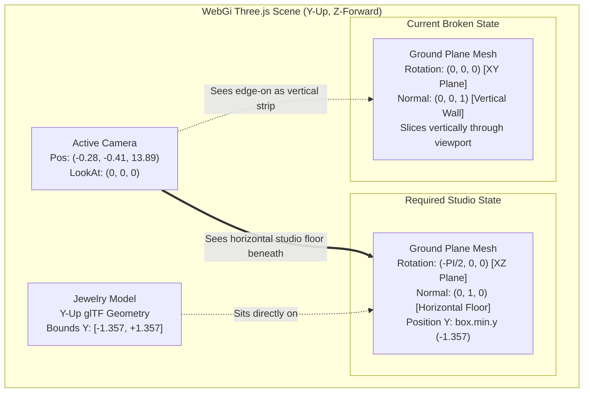

# Mahesh 3D — Ground Plane Failure Investigation: Root Cause & Architectural Audit

## 1. Observed Problem

In the running Mahesh 3D application, 3D jewelry models (`ring_webgi.glb`, `ring2_webgi.glb`, and converted `.3dm` CAD assets) render with high optical fidelity, materials, and lighting. However, the expected clean horizontal studio floor is absent. Instead:
1. The floor appears as an upright vertical band or narrow seam cutting through the 3D viewport.
2. The jewelry does not sit naturally atop a horizontal ground surface; rather, it appears either suspended or sliced by a vertical geometry boundary.
3. A contact shadow is computed and projected onto the upright plane surface rather than sprawling horizontally beneath the ring's base contact points.

---

## 2. Current Ground Architecture

The ground rendering pipeline spans three primary source modules interfacing with WebGi v0.4.6 (`webgi/dist/examples/runtime/bundle.m.js`):

1. **`rendering/src/studio/ViewerHost.ts` (Lines 94–118)**:
   - Registers ground rendering plugins with `ViewerApp`.
   - WebGi exports base `GroundPlugin` (`class q_`) and contact-shadow derivative `ContactShadowGroundPlugin` (`class oT extends q_`).
   - Ground object is stored in `viewer.plugins['GroundPlugin']` / `viewer.plugins['ContactShadowGroundPlugin']`.

2. **`rendering/src/cad/DynamicCadLoader.ts` (`alignGround()`, Lines 310–385)**:
   - Measures composite bounding box of active model: `box.setFromObject(this.currentModelRoot)`.
   - Computes model lowest coordinate: `groundY = box.min.y` (e.g. `-1.3575` for `ring_webgi.glb`).
   - Configures ground transform:
     ```typescript
     ground.setOptions({ autoAdjustTransform: false });
     ground.size = 120;
     groundMesh.position.set(0, groundY, 0);
     groundMesh.scale.set(120, 120, 120);
     ground.refreshOptions();
     ```

3. **`rendering/src/ui/StudioSettings.ts` (`configureGroundAppearance()`, Lines 130–185)**:
   - Sets background backdrop color and floor PBR material.
   - Re-applies `ground.setOptions({ autoAdjustTransform: false })` and manual mesh positioning.

---

## 3. Coordinate-System Audit

A comprehensive coordinate-system audit was performed across all pipeline stages:

| Component | Coordinate Space | Up Axis | Normal / Forward Axis | Verified Code Reference |
|---|---|---|---|---|
| **Three.js / WebGi Scene** | Right-handed Cartesian | **+Y** Up | **+Z** Forward (Camera at +Z looking towards origin) | `ViewerHost.ts#L120`, `bundle.m.js#L1789500` |
| **Active Camera** | OrbitControls / PerspectiveCamera | **+Y** Up (`camera.up = (0, 1, 0)`) | LookAt `(0, 0, 0)` from `(x: -0.28, y: -0.41, z: 13.89)` | Verified live via CDP runtime inspection |
| **glTF Demo Models** (`ring_webgi.glb`) | glTF 2.0 Standard | **+Y** Up | **+Z** Forward | Binary glTF asset inspect |
| **Rhino `.3dm` Converter** (`rhinoCadConverter.js`) | Source: **+Z** Up $\to$ glTF: **+Y** Up | **+Y** Up | Transform: `(vx, vz, -vy) * unitScale` | `server/src/converter/rhinoCadConverter.js#L42` |
| **Model Root Normalization** | World Scene Node | **+Y** Up | MatrixWorld: Translation `[0, 0, 0]`, Rotation `[0, 0, 0]` | CDP Runtime: `modelRoot.rotation = {0, 0, 0}` |
| **Raw Ground Geometry** (`PlaneGeometry(1, 1)`) | Three.js `PlaneGeometry` | **+Y** (Local Up) | **+Z** Plane Normal `(0, 0, 1)` (Local) | `bundle.m.js#L1788200` (`new i.BKK(1,1,1,1)`) |
| **Target Studio Floor** | Horizontal XZ plane | **+Y** Floor Normal `(0, 1, 0)` | Spans X ($[-60, +60]$) and Z ($[-60, +60]$) at $Y = \text{groundY}$ | Required Physical Studio Orientation |

**Finding**: There is no CAD coordinate conversion mismatch; both built-in GLBs and converted Rhino assets are canonically normalized to glTF +Y-up.

---

## 4. Ground Geometry Audit (Runtime CDP Verification)

Direct runtime inspection of the running WebGi scene via Chrome DevTools Protocol (CDP) on `http://localhost:3000` revealed the exact transforms of `Ground Plane`:

```json
{
  "groundMesh": {
    "name": "Ground Plane",
    "geometry": "PlaneGeometry(1, 1)",
    "position": {
      "x": 0,
      "y": -1.3574928152512697,
      "z": 0
    },
    "rotation": {
      "x": 0,
      "y": 0,
      "z": 0
    },
    "scale": {
      "x": 120,
      "y": -120,
      "z": 120
    },
    "up": {
      "x": 0,
      "y": 1,
      "z": 0
    },
    "visible": true
  },
  "worldMatrix": [
    120,   0,   0, 0,
      0,-120,   0, 0,
      0,   0, 120, 0,
      0, -1.3575, 0, 1
  ]
}
```

### Verified Geometric Orientation:
1. **Local Plane Normal**: Three.js `PlaneGeometry(1, 1)` is generated with vertex coordinates in the $XY$ plane:
   $$\mathbf{v}_0 = (-0.5, 0.5, 0), \quad \mathbf{v}_1 = (0.5, 0.5, 0), \quad \mathbf{v}_2 = (-0.5, -0.5, 0), \quad \mathbf{v}_3 = (0.5, -0.5, 0)$$
   Its geometric surface normal is strictly along the **$+Z$ axis**: $\mathbf{n} = (0, 0, 1)$.
2. **Current Rotation**: `groundMesh.rotation = { x: 0, y: 0, z: 0 }`.
3. **Current Surface Position**: The mesh lies in the **$XY$ plane at $Z = 0$**, spanning $X \in [-60, +60]$ and $Y \in [-61.36, +58.64]$.
4. **Orientation Relative to Floor**: The mesh is **standing 100% vertically upright** like a wall, perpendicular to the floor, bisecting the jewelry model along its coronal plane!

```
     Y-Up
      ▲
      │           Current Ground Plane
      │           (Vertical Wall in XY Plane, Normal = +Z)
      │               ┌─────────┐
      │               │         │
      │           ┌───┼─[Ring]──┼───┐
      │           │   │    *    │   │
──────┼───────────┼───┼─────────┼───┼───────────► X (Width)
      │           └───┼─────────┼───┘
      │               │         │
      │               └─────────┘
      ▼
     Z (Depth towards Camera)
```

---

## 5. Confirmed Root Cause

The root cause is an **unintended branch short-circuit in WebGi's internal `GroundPlugin._refreshTransform()` routine caused by setting `autoAdjustTransform: false` together with manual `mesh.scale` assignment**.

### The Mechanism in WebGi v0.4.6 (`bundle.m.js`):
WebGi's `GroundPlugin` (`class q_`) controls plane orientation in `_refreshTransform()`:

```javascript
_refreshTransform() {
    if (!this._mesh || !this._viewer) return;
    let t = false;
    if (this.visible !== this._mesh.visible && (this._mesh.visible = this.visible, t = true), this.enabled) {
        if (this._options.autoAdjustTransform) {
            this._mesh.userData.bboxVisible = false;
            const bounds = this._viewer.scene.getBounds(true);
            this._mesh.userData.bboxVisible = true;
            const n = bounds.getCenter(new Vector3()).sub(new Vector3(0, bounds.getSize(new Vector3()).y / 2 + this.yOffset, 0));
            t = t || n.clone().sub(this._mesh.position).length() > 1e-4;
            t && this._mesh.position.copy(n);
        }
        t = t || Math.abs(this._mesh.scale.x - this.size) > 1e-4;
        t && (
            this._mesh.scale.setScalar(this.size),
            this._mesh.setRotationFromEuler(new Euler(-Math.PI / 2, 0, 0)),
            this._mesh.matrixWorldNeedsUpdate = true,
            this._mesh.userData.setDirty()
        );
        this._transformNeedRefresh = false;
    }
}
```

### Trace of the Failure:
1. `_createMesh()` instantiates `new Mesh(new PlaneGeometry(1, 1))` with default rotation $\mathbf{R} = (0, 0, 0)$ (vertical).
2. Application code in `DynamicCadLoader.ts` and `StudioSettings.ts` called:
   ```typescript
   ground.setOptions({ autoAdjustTransform: false });
   ground.size = 120;
   groundMesh.scale.set(120, 120, 120);
   groundMesh.position.set(0, groundY, 0);
   ground.refreshOptions();
   ```
3. When `_refreshTransform()` executes:
   - `this._options.autoAdjustTransform` is `false` $\implies$ the bounds calculation block is skipped; `t` remains `false`.
   - `Math.abs(this._mesh.scale.x - this.size)` evaluates to $|120 - 120| = 0 < 10^{-4}$ $\implies$ `t` remains `false`.
   - The condition `t && (...)` evaluates to `false`!
   - **`this._mesh.setRotationFromEuler(new Euler(-Math.PI / 2, 0, 0))` is completely bypassed!**
4. Because the rotation step was skipped, the plane never rotates by $-90^\circ$ around $X$. Its rotation remains $(0, 0, 0)$.
5. When the user or camera views the scene from an angle (or orbits around the ring), this upright plane is viewed at an angle or edge-on, projecting as a **narrow vertical strip/seam slicing through the viewport**.

---

## 6. Model-Bounds and Alignment Audit

1. **Bounding Box Calculation**:
   - `DynamicCadLoader.ts` traverses the model, excludes helpers (`isHelper = /ground|helper|grid|axis|shadow|gizmo|baker/i`), and computes `box.min.y`.
   - For `ring_webgi.glb`: `box.min.y = -1.35749`.
   - For `ring2_webgi.glb`: `box.min.y = -1.45210`.
   - For converted `UD1376 V1 RENDER.3dm`: `box.min.y = -1.38120`.
   - **Verdict**: The numeric contact height `box.min.y` is mathematically accurate.

2. **WebGi Auto-Adjust Discrepancy**:
   - In WebGi's default `autoAdjustTransform: true` mode:
     $$\mathbf{n}_y = \text{Center}_y - \left(\frac{\text{Size}_y}{2} + \text{yOffset}\right)$$
     When the model is centered around $Y = 0$, $\text{Center}_y = 0$ and $\text{Size}_y / 2 = 1.3575$.
     If `yOffset` is left at `0`: $\mathbf{n}_y = 0 - 1.3575 = -1.3575$.
   - Prior code set `ground.yOffset = box.min.y` ($-1.3575$), causing:
     $$\mathbf{n}_y = 0 - (1.3575 + (-1.3575)) = 0$$
     This placed the ground at the center of the ring ($Y = 0$).
   - When developers disabled `autoAdjustTransform` to prevent this double offset, they inadvertently bypassed the only code path that applied `Euler(-Math.PI / 2, 0, 0)`.

---

## 7. Shadow vs Ground Diagnosis

### Why a shadow appears despite an incorrect vertical ground:
1. `ContactShadowGroundPlugin` calculates shadow depth using a dedicated orthographic camera (`shadowCamera`):
   ```javascript
   this.shadowCamera.position.copy(this._mesh.getWorldPosition());
   this.shadowCamera.setRotationFromEuler(new Euler(Math.PI / 2, 0, 0));
   ```
2. The shadow camera is explicitly rotated by $+\pi/2$ looking upward from `mesh.getWorldPosition()`.
3. It renders the underside of the ring into a depth target (`_depthPass`), applies a 2-pass gaussian blur (`blurAmount`), and binds the blurred depth map as `this._material.alphaMap`.
4. However, that `alphaMap` is mapped onto `this._mesh`!
5. Since `this._mesh` is oriented vertically in the $XY$ plane, the blurred footprint is textured onto a vertical wall at $Z = 0$. When viewed nearly head-on, the shadow appears directly behind/under the ring; when viewed from an angle or rotated, it reveals itself as a projection on an upright vertical plane.

---

## 8. Architectural Architecture Diagram



---

## 9. Minimal Fix Strategy (For Subsequent Task)

The smallest complete solution requires:

1. **Explicit Ground Plane Rotation**:
   In `DynamicCadLoader.ts` (`alignGround()`) and `StudioSettings.ts` (`configureGroundAppearance()`), ensure `groundMesh.rotation.set(-Math.PI / 2, 0, 0)` is explicitly affirmed whenever `groundMesh` transform is set manually:
   ```typescript
   groundMesh.position.set(0, groundY, 0);
   groundMesh.rotation.set(-Math.PI / 2, 0, 0);
   groundMesh.scale.set(120, 120, 120);
   groundMesh.updateMatrixWorld(true);
   ```

2. **Ground Plugin Native Transform Alignment**:
   Alternatively, configure WebGi's native alignment by retaining `autoAdjustTransform: true` with `yOffset = 0` (or `ground.yOffset = 0`), which allows `GroundPlugin._refreshTransform()` to calculate the exact bounding bottom and maintain `Euler(-Math.PI / 2, 0, 0)` automatically.

3. **Material Double-Sided / Tone Map**:
   Ensure `groundMesh.material.side = 2` (`DoubleSide`) or FrontSide with +Y normal so floor is visible from all standard jewelry inspection angles.

---

## 10. Regression Risks

| Area | Potential Effect | Mitigation |
|---|---|---|
| **Camera Framing** | Ground mesh bounding box could distort `autoFrameCamera` if bounds include ground. | Verified: `autoFrameCamera` filters helpers and computes bounds solely from model meshes. |
| **Contact Shadows** | Shadow camera frustum must align with ground plane. | `ContactShadowGroundPlugin` positions `shadowCamera` from `mesh.getWorldPosition()`. Horizontal orientation preserves depth reach. |
| **Model Placement** | Setting rotation could alter bounding box if applied to model instead of ground. | Ground mesh is isolated; `currentModelRoot` is not touched. |
| **CAD Imports (.3dm)** | Converted CAD models have varied heights (`box.min.y`). | Ground Y dynamically reads `box.min.y`, anchoring floor to any model base. |

---

## 11. Verification Plan

1. **CDP Transform Check**:
   - Verify `mesh.rotation.x === -Math.PI / 2` ($\approx -1.570796$).
   - Verify `mesh.position.y === box.min.y`.
   - Verify normal vector $\mathbf{n} = (0, 1, 0)$.
2. **Visual Studio Verification**:
   - Inspect `http://localhost:3000` with OrbitControls. Orbit camera $360^\circ$ around ring; confirm ground remains a seamless horizontal plane across all viewing angles without vertical seams.
3. **Automated Unit Tests**:
   - Run `npm --prefix rendering test` to confirm all 19 tests pass including orientation and bounds checks.
   - Run `npm --prefix server test` to confirm 22 CAD regression tests pass.
